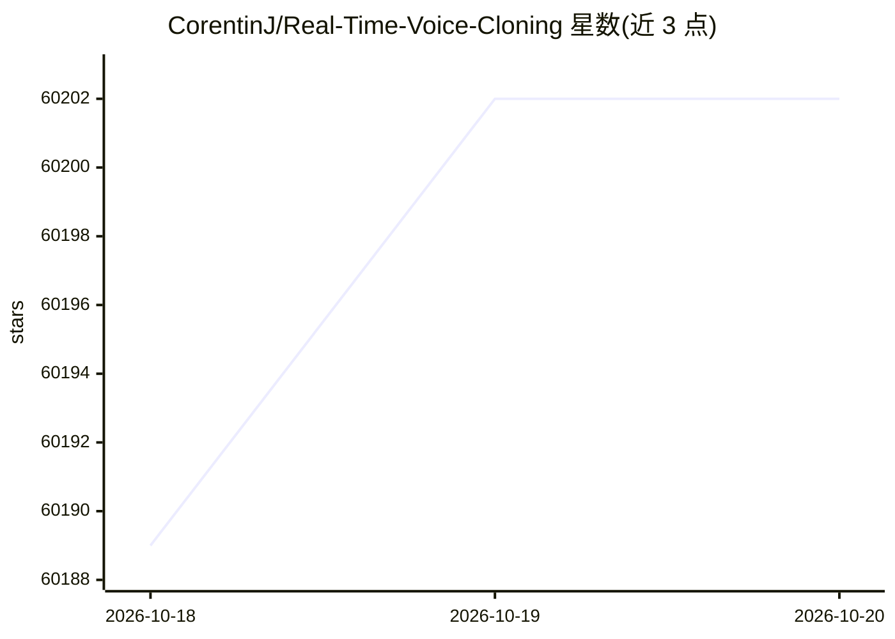

# CorentinJ/Real-Time-Voice-Cloning

⭐ 60,202 · Python · NOASSERTION · 推送 2026-03-09 · [GitHub](https://github.com/CorentinJ/Real-Time-Voice-Cloning) · 个人维护

**5 秒音频克隆声音、实时生成任意语音的工具箱**

基于 SV2TTS 三阶段深度学习框架的声音克隆实现：从几秒音频提取声纹的数字表示，再以该表示为参考，由任意文本合成语音，配套的 toolbox 可实时运行。作者硕士论文成果，实现了 SV2TTS、GE2E、Tacotron、WaveRNN 四篇论文。支持 Windows 与 Linux，依赖 ffmpeg 读音频，用 uv 管理 Python 环境，预训练模型自动下载，可选用 LibriSpeech 等数据集。README 提示项目已随深度学习进展显旧，推荐关注更新的开源替代。

## 筛选速览

| 维度 | 判定 | 备注 |
|---|---|---|
| AI 角色 | `ai-native` | 本体是模型或模型工具 |
| 许可风险 | `none` | NOASSERTION |
| 部署形态 | `None` |  |
| 模型依赖 | — | README 未给出锁定关系 |
| 硬件要求 | — | 无带数字的原话,不猜 |
| 安装摩擦 | `medium` | 含编译或系统依赖之一 |
| 成熟度 | — | 结构信号不足 |

## 动量与使用信号

- 维护:`declining` — 距上次 push 222.9 天,年发版 0,17 位贡献者
- 涨星:近 1 天 **-5**(自 20261016 起算)
- 平台:WINDOWS / LINUX · 协议:—

## 能力要点

- SV2TTS 三阶段框架：声纹表示→文本合成，vocoder 实时运行
- 实现 4 篇论文（SV2TTS/GE2E/Tacotron/WaveRNN）
- 预训练模型自动下载，也可从 Hugging Face 手动获取
- uv 自动创建虚拟环境，支持 NVIDIA GPU 与 CPU 两种运行方式

## 适用场景

- 用几秒录音克隆音色并合成任意文本语音
- 作为语音合成论文实现的实验与研究平台
- 用 toolbox 录制或准备自己的音频数据

## 场景标签

`语音合成` · 领域:内容生成

## 证据(README 行号)

> L3: This repository is an implementation of [Transfer Learning from Speaker Verification to
> L6: SV2TTS is a deep learning framework in three stages. In the first stage, one creates a digital representation of a v
> L30: Both Windows and Linux are supported.

## 星数曲线

2026-10-18 60,189 → 2026-10-20 60,202（+13）

---
*卡片 v1 · prompt 1.4 · 生成 2026-10-18 · 置信度 high · 依据 README sha `c0d9784c267b` · [字段定义](../../DATASET.md)*
