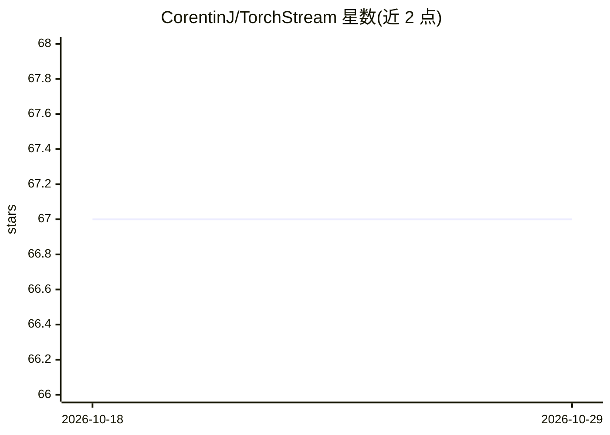

# CorentinJ/TorchStream

⭐ 67 · Python · MIT · 推送 2026-01-23 · [GitHub](https://github.com/CorentinJ/TorchStream) · 个人维护

**让 PyTorch 模型可流式运行的库，无需重训或改写**

面向 ML 开发者的 Python 库：将已有的 PyTorch 模型与序列到序列变换转为流式（streaming）执行，以降低延迟或适配实时应用，且不需要重新训练或改写模型。提供 pip 包安装（CUDA 可选），也可克隆仓库用 uv 运行附带 Streamlit 示例；附有在线示例网站，示例中演示了对 BigVGAN 神经声码器的流式处理。声明与 PyTorch 团队及 Meta 无隶属关系。

## 筛选速览

| 维度 | 判定 | 备注 |
|---|---|---|
| AI 角色 | `ai-ecosystem` | LLM/agent 周边工具 |
| 许可风险 | `permissive` | MIT |
| 部署形态 | `library` | 以包/库形式分发 |
| 模型依赖 | — | README 未给出锁定关系 |
| 硬件要求 | — | 无带数字的原话,不猜 |
| 安装摩擦 | `medium` | 含编译或系统依赖之一 |
| 成熟度 | — | 结构信号不足 |

## 能力要点

- 不重训、不改写即可让 PyTorch 模型流式执行
- 支持复杂神经网络与序列到序列变换的流式处理
- 附带 Streamlit 在线/本地示例（含 BigVGAN 流式演示）

## 适用场景

- 把已训练的 PyTorch 模型改成低延迟流式推理
- 语音等实时应用中流式运行序列模型
- 运行自带示例体验流式推理效果

## 场景标签

`推理引擎` · 领域:训练与推理

## 证据(README 行号)

> L3: TorchStream is a library to help ML developers stream PyTorch models **without retraining nor rewriting them**,
> L30: TorchStream offers a set of tools to help you stream complex neural networks and other sequence to sequence transfo

## 星数曲线

2026-10-18 67 → 2026-10-29 67（+0）

---
*卡片 v1 · prompt 1.4 · 生成 2026-10-24 · 置信度 high · 依据 README sha `032af3326b2f` · [字段定义](../../DATASET.md)*
