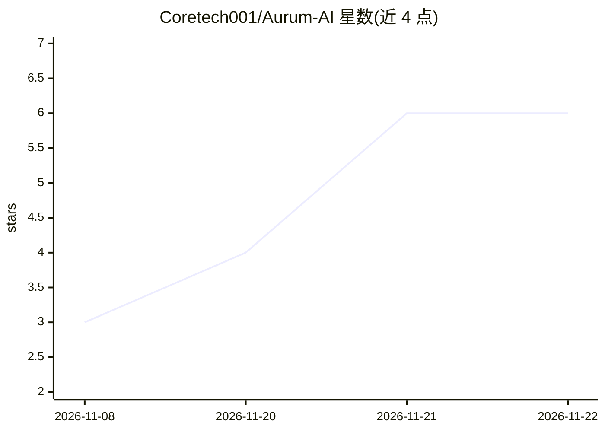

# Coretech001/Aurum-AI

⭐ 6 · Python · 推送 2026-10-30 · [GitHub](https://github.com/Coretech001/Aurum-AI) · 个人维护

**面向交易者的黄金市场分析与算法交易平台**

基于 Python/Tkinter 的桌面平台，功能覆盖市场行情监控仪表盘、通过 Subgraph 分析市场指标与相关性、本地模型训练实验，以及经由 MQL5 Expert Advisor 与 MetaTrader 5 集成的算法交易执行。项目正在向 Rust/React/TypeScript/Tauri 架构迁移（尚未完成）。提供 Windows 安装包（PyInstaller + Inno Setup），本地许可管理分 Free/Pro/Business 三档，设计为本地运行、无托管 API 与遥测。README 强调交易风险并要求在 demo 环境验证。

## 筛选速览

| 维度 | 判定 | 备注 |
|---|---|---|
| AI 角色 | `ai-enhanced` | 去掉 AI 部分产品仍成立 |
| 许可风险 | `none` | — |
| 部署形态 | `desktop` | 安装包/桌面程序 |
| 模型依赖 | — | README 未给出锁定关系 |
| 硬件要求 | — | 无带数字的原话,不猜 |
| 安装摩擦 | `low` | 无编译、无系统依赖或容器化 |
| 成熟度 | `idea` | |

## 能力要点

- 通过 MQL5 Expert Advisor 集成 MetaTrader 5 执行交易
- Market Intelligence 分析指标、收益相关性与市场状态分类
- 本地模型训练实验环境
- 本地许可管理与模拟盘策略共享

## 适用场景

- 监控黄金市场行情与持仓状态
- 在模拟盘环境中测试算法交易策略
- 在本地环境做模型训练实验

## 场景标签

`金融量化` `模型训练` · 领域:学习与行业

## 证据(README 行号)

> L5: **Aurum AI** is a desktop platform for gold market monitoring, market analysis, algorithmic trading, and local model
> L14: - **Market Intelligence** — Analyze market indicators, return correlations, and market regime classifications throu
> L15: - **Local Model Training** — Experiment with model training in a local environment.

## 星数曲线

2026-11-08 3 → 2026-11-22 6（+3）

---
*卡片 v1 · prompt 1.4 · 生成 2026-11-21 · 置信度 high · 依据 README sha `5b59c83c5d48` · [字段定义](../../DATASET.md)*
