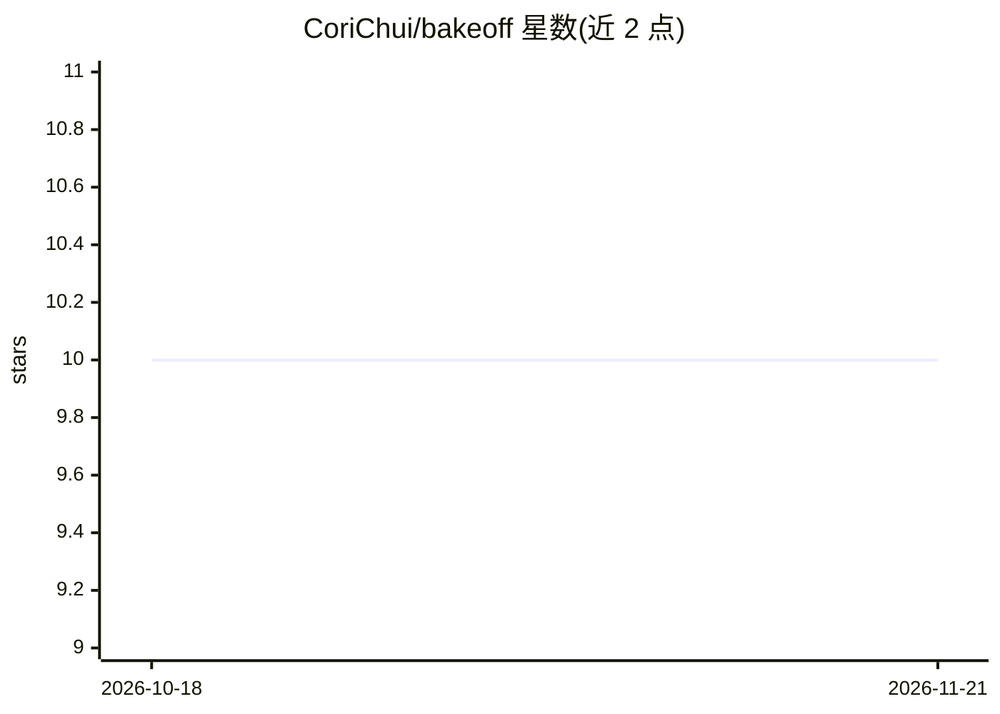

# CoriChui/bakeoff

⭐ 10 · JavaScript · MIT · 推送 2026-07-09 · [GitHub](https://github.com/CoriChui/bakeoff) · 个人维护

**Claude Code 技能：把一个决策变成候选方案的评审锦标赛**

bakeoff 是一个 Claude Code 技能：用户输入一个决策问题后，自动生成多个候选方案、为该问题推导评分标准、用独立评委打分并给出排名与获胜理由。机制包括多角色候选生成、双评委独立打分并由确定性脚本按低分规则合并、位置偏差控制（乱序展示）、对领先者的对抗性反驳环节，以及可与候选生成并行且对其盲构建的评分标准。每次运行保存含分数矩阵的审计报告。要求 Claude Code 与 Node.js；不适用于可由测试/lint 直接判定的单产物问题。

## 筛选速览

| 维度 | 判定 | 备注 |
|---|---|---|
| AI 角色 | `ai-native` | 本体是模型或模型工具 |
| 许可风险 | `permissive` | MIT |
| 部署形态 | `library` | 以包/库形式分发 |
| 模型依赖 | locked-api |  |
| 硬件要求 | — | 无带数字的原话,不猜 |
| 安装摩擦 | `low` | 无编译、无系统依赖或容器化 |
| 成熟度 | — | 结构信号不足 |

## 能力要点

- 自动为具体问题推导评分标准，无需用户指定维度与权重
- 双评委独立打分，确定性脚本按低分规则合并分歧
- 对领先候选执行对抗性反驳环节
- 每轮生成保存的报告（推荐、分数矩阵、评委一致度、评分标准）

## 适用场景

- 在多个都站得住脚的架构方案之间做选择
- 为库/数据库/工具选型获取带理由的排名
- 评估 AI 给出的建议是否存在更好的替代方案
- 不可逆决策（迁移、数据模型、安全相关取舍）前的方案比选

## 场景标签

 · 领域:LLM 应用/决策评估

## 证据(README 行号)

> L9: `bakeoff` is a Claude Code skill. Hand it a decision and it **generates diverse candidate solutions**, **auto-derive
> L64: - **Claude Code** (skills support).

## 星数曲线

2026-10-18 10 → 2026-11-21 10（+0）

---
*卡片 v1 · prompt 1.4 · 生成 2026-11-20 · 置信度 high · 依据 README sha `55ee193ab115` · [字段定义](../../DATASET.md)*
