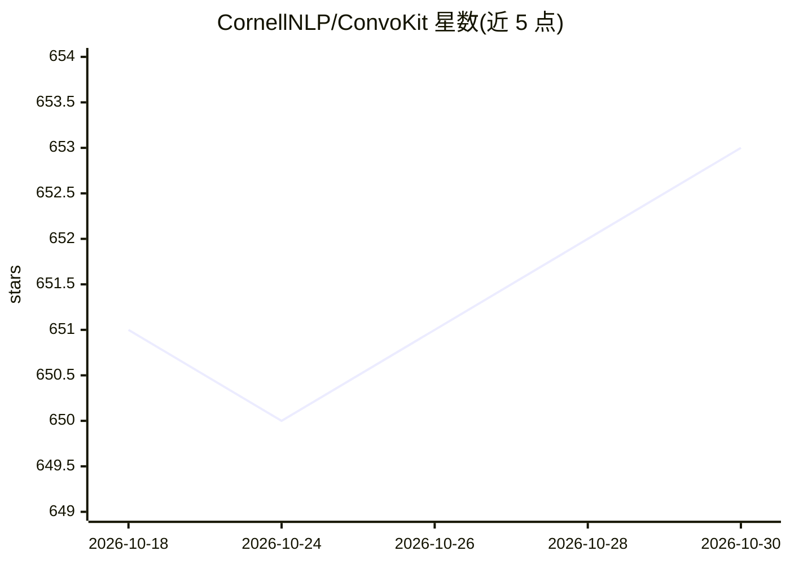

# CornellNLP/ConvoKit

⭐ 653 · Jupyter Notebook · MIT · 推送 2026-10-16 · [GitHub](https://github.com/CornellNLP/ConvoKit) · [官网](https://convokit.cornell.edu/documentation/) · 组织维护

**对话分析工具包：为研究者和开发者提取对话特征与社会现象**

Cornell NLP 组维护的 Python 工具包，提供统一接口（与 scikit-learn 兼容）提取对话特征并分析社会现象，如语言协调度、礼貌策略、对话走势预测（CRAFT 神经模型）、超图结构表示、关键转折点识别等。随包附带 20 余个开箱即用的对话数据集（Wikipedia、Reddit、最高法院、电影对白等），可用 convokit.download() 下载，也支持加载自定义语料。需 Python 3.10+，安装后还需下载 spaCy 英文模型与 NLTK punkt 模型。

## 筛选速览

| 维度 | 判定 | 备注 |
|---|---|---|
| AI 角色 | `ai-native` | 本体是模型或模型工具 |
| 许可风险 | `permissive` | MIT |
| 部署形态 | `library` | 以包/库形式分发 |
| 模型依赖 | — | README 未给出锁定关系 |
| 硬件要求 | — | 无带数字的原话,不猜 |
| 安装摩擦 | `low` | 无编译、无系统依赖或容器化 |
| 成熟度 | — | 结构信号不足 |

## 能力要点

- 统一接口实现语言协调度、礼貌策略、转折点等多项对话分析方法
- 附带 20 余个对话数据集，convokit.download() 一键获取
- CRAFT 神经模型可对对话结果进行在线预测
- 支持通过 convokit.Corpus 对象加载自定义数据集

## 适用场景

- 对 Reddit/Wikipedia 等社区对话做社会现象计算分析
- 获取现成标注对话语料用于研究或建模
- 预测对话走向（如是否恶化为人身攻击）

## 场景标签

`科研工具` · 领域:学习与行业

## 证据(README 行号)

> L11: This toolkit contains tools to extract conversational features and analyze social phenomena in conversations, using
> L44: A neural model for forecasting future outcomes of conversations (e.g., derailment into personal attacks) as they de

## 星数曲线

2026-10-18 651 → 2026-10-30 653（+2）

---
*卡片 v1 · prompt 1.4 · 生成 2026-10-21 · 置信度 high · 依据 README sha `8ac0d623fd0c` · [字段定义](../../DATASET.md)*
