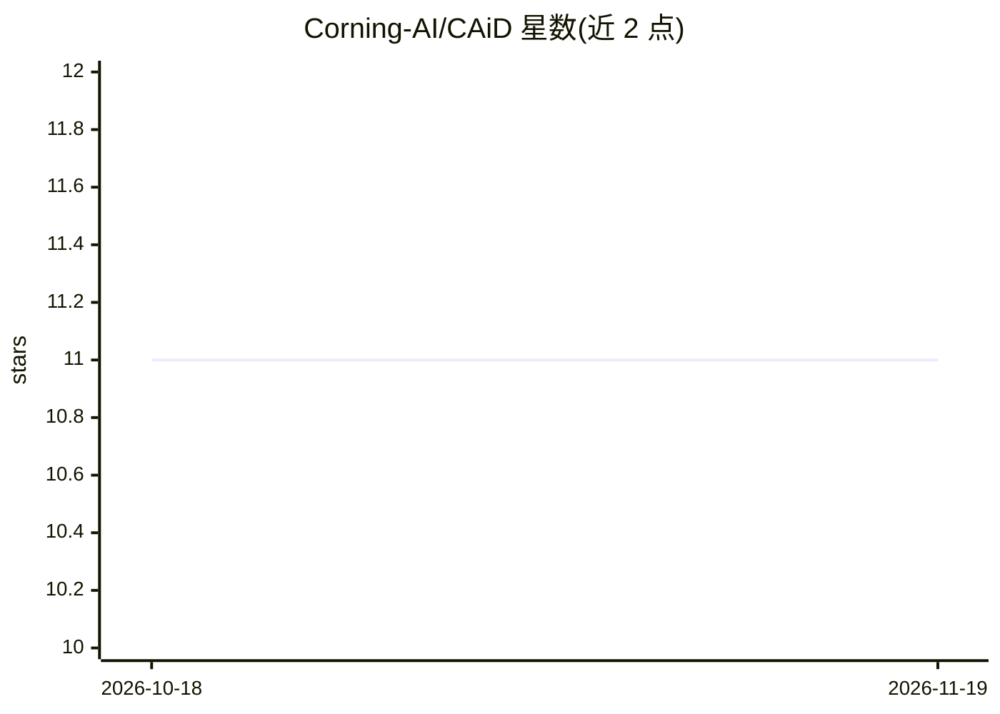

# Corning-AI/CAiD

⭐ 11 · MIT · 推送 2026-01-05 · [GitHub](https://github.com/Corning-AI/CAiD) · 组织维护

**AI agent：将设计概念与自然语言转为参数化 3D CAD 模型**

CAiD 定位为 AI 驱动的 CAD 建模 agent，读取自然语言设计描述，生成可参数化修改的 3D CAD 模型，覆盖参数化设计自动化、装配约束管理、设计校验（兼容 FEA/CFD 分析工具）及 STEP/IGES/STL/BREP 等格式导出。目标用户为工程师与设计师。架构由 NLP 引擎、参数化建模核心、约束求解器、优化模块与导出引擎组成。注意：安装说明、用法示例与 CLI 文档均标注 coming soon，尚未提供。

## 筛选速览

| 维度 | 判定 | 备注 |
|---|---|---|
| AI 角色 | `ai-native` | 本体是模型或模型工具 |
| 许可风险 | `permissive` | MIT |
| 部署形态 | `None` |  |
| 模型依赖 | — | README 未给出锁定关系 |
| 硬件要求 | — | 无带数字的原话,不猜 |
| 安装摩擦 | `low` | 无编译、无系统依赖或容器化 |
| 成熟度 | `idea` | |

## 能力要点

- 自然语言描述转参数化 3D CAD 模型生成
- 支持 STEP/IGES/STL/BREP 等行业标准格式导出
- 装配约束管理与层级装配结构支持
- 声明兼容 FEA/CFD 分析工具集成

## 适用场景

- 快速生成机械零件（紧固件、支架等标准件）
- 从规格生成多零件装配体与物料清单
- 制造前的概念可视化与设计验证
- 建筑构件与结构单元建模

## 场景标签

`代码生成` · 领域:编码与开发

## 证据(README 行号)

> L12: **CAiD** is an AI-driven CAD modeling agent that transforms design concepts and natural language descriptions into 
> L75: Coming soon! Follow this space for installation instructions.

## 星数曲线

2026-10-18 11 → 2026-11-19 11（+0）

---
*卡片 v1 · prompt 1.4 · 生成 2026-11-19 · 置信度 mid · 依据 README sha `7e6e2b81d2b2` · [字段定义](../../DATASET.md)*
