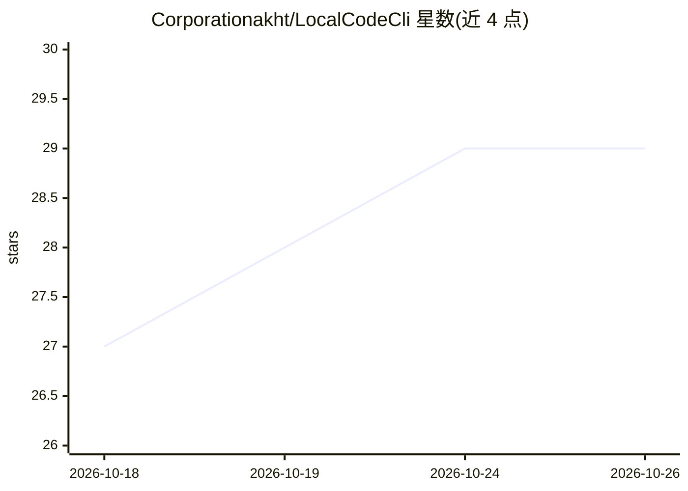

# Corporationakht/LocalCodeCli

⭐ 29 · Python · MIT · 推送 2026-09-03 · [GitHub](https://github.com/Corporationakht/LocalCodeCli) · [官网](https://github.com/Corporationakht/LocalCodeCli) · 个人维护 · 中文 README

**本地代理：让 Claude Code/Codex CLI 接入自选 AI 提供商**

运行在本机的代理服务器，将 Claude Code（CLI 与 VS Code 扩展）的 Anthropic Messages API 流量和 Codex 的 OpenAI Responses API 流量转发到 17+ 个提供商（Google Gemini、DeepSeek、NVIDIA NIM、OpenRouter、本地 Ollama 等），保持各客户端协议不变。提供 /admin 网页管理 API key 与模型配置，支持按 Opus/Sonnet/Haiku 层级做多模型路由，附 lcc-claude / lcc-codex 启动命令，可选 Discord/Telegram 机器人远程会话与语音转写（Whisper 本地或 NVIDIA NIM ASR）。要求 Python 3.14 与 uv，通过安装脚本或源码运行。

## 筛选速览

| 维度 | 判定 | 备注 |
|---|---|---|
| AI 角色 | `ai-ecosystem` | LLM/agent 周边工具 |
| 许可风险 | `permissive` | MIT |
| 部署形态 | `None` |  |
| 模型依赖 | local-ok | 支持本地模型 |
| 硬件要求 | — | 无带数字的原话,不猜 |
| 安装摩擦 | `low` | 无编译、无系统依赖或容器化 |
| 成熟度 | — | 结构信号不足 |

## 能力要点

- 17+ 提供商接入，支持免费层（Gemini）与本地 Ollama 离线模型
- Opus/Sonnet/Haiku 按层级路由到不同提供商模型
- /admin 网页管理 API key、模型与配置，保存于 ~/.lcc/.env
- Discord/Telegram 机器人远程运行 Claude Code 会话，支持语音转写

## 适用场景

- 用自己的 Gemini/DeepSeek API key 免费在终端跑 Claude Code 和 Codex
- 把编码 agent 流量切到本地 Ollama 模型实现离线使用
- 在编辑器或聊天机器人中远程使用编码 agent 会话

## 场景标签

`模型网关` · 领域:Agent 开发

## 证据(README 行号)

> L16: Local Code CLI routes Anthropic Messages API traffic from Claude Code (CLI and VS Code extension) and OpenAI Respon
> L40: |🔀 **Multi-Provider**|Pilih dari 17+ provider: Google Gemini (gratis!), DeepSeek, NVIDIA NIM, OpenRouter, Ollama, d

## 星数曲线

2026-10-18 27 → 2026-10-26 29（+2）

---
*卡片 v1 · prompt 1.4 · 生成 2026-10-26 · 置信度 high · 依据 README sha `461c28cf58a0` · [字段定义](../../DATASET.md)*
