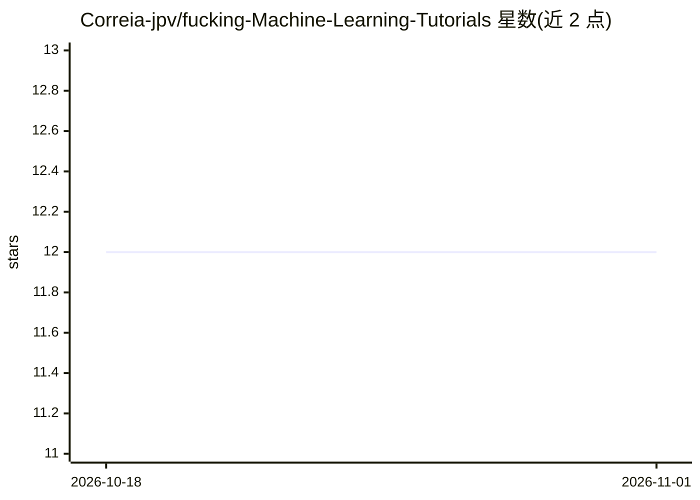

# Correia-jpv/fucking-Machine-Learning-Tutorials

⭐ 12 · CC0-1.0 · 推送 2026-10-30 · [GitHub](https://github.com/Correia-jpv/fucking-Machine-Learning-Tutorials) · 个人维护

**机器学习与深度学习教程资源的主题分类策展清单**

按主题组织的机器学习与深度学习教程、文章及资源聚合清单，条目附带来源仓库的 star 与 fork 数量。覆盖入门课程、面试资源、人工智能、遗传算法、统计、博客、Quora 问答、Kaggle 竞赛复盘、速查表，以及分类、线性/逻辑回归、模型验证、交叉验证、自助法、深度学习等技术主题，每个主题下罗列文章、视频课程、讲义与相关 GitHub 仓库链接。面向机器学习学习者和求职准备者，提供贡献指南接受社区补充。清单无安装运行形态，纯浏览使用。

## 筛选速览

| 维度 | 判定 | 备注 |
|---|---|---|
| AI 角色 | `ai-knowledge` | 知识聚合/清单类 |
| 许可风险 | `viral` | CC0-1.0 |
| 部署形态 | `None` |  |
| 模型依赖 | — | README 未给出锁定关系 |
| 硬件要求 | — | 无带数字的原话,不猜 |
| 安装摩擦 | `low` | 无编译、无系统依赖或容器化 |
| 成熟度 | — | 结构信号不足 |

## 能力要点

- 按 20 余个主题分类组织教程与文章链接
- 条目标注来源仓库的 star/fork 数据
- 覆盖从入门课程到 Kaggle 竞赛复盘、面试准备的学习路径
- 提供贡献指南接受社区补充

## 适用场景

- 系统性查找机器学习某一主题（如交叉验证、深度学习）的教程与讲义
- 准备数据科学/机器学习面试时收集问答资源
- 通过 star 数量参考筛选高质量学习仓库

## 场景标签

`精选清单` · 领域:学习与行业

## 证据(README 行号)

> L3: - This repository contains a topic-wise curated list of Machine Learning and Deep Learning tutorials, articles and o
> L5: - If you want to contribute to this list, please read Contributing Guidelines.

## 星数曲线

2026-10-18 12 → 2026-11-01 12（+0）

---
*卡片 v1 · prompt 1.4 · 生成 2026-11-01 · 置信度 high · 依据 README sha `119eed7b3eb5` · [字段定义](../../DATASET.md)*
