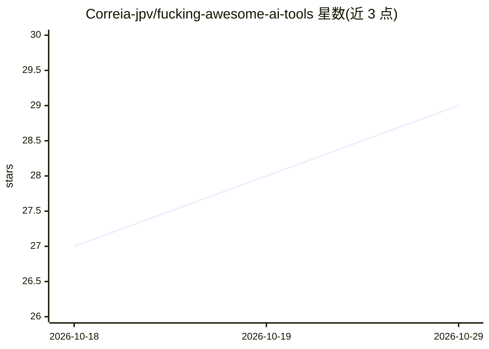

# Correia-jpv/fucking-awesome-ai-tools

⭐ 29 · MIT · 推送 2026-10-28 · [GitHub](https://github.com/Correia-jpv/fucking-awesome-ai-tools) · 个人维护

**AI 工具精选清单：按类别收录模型、聊天、写作等工具及星标**

个人维护的 awesome 类策展清单，按文本模型、聊天机器人、搜索引擎、本地搜索、写作助手、ChatGPT 扩展、生产力等类别收录 AI 工具条目，部分开源项目附 GitHub 星标与 fork 数。条目以链接加一句话简介形式呈现，支持通过 PR 提交新产品，并关联 altern.ai 站点与 Altern Newsletter 更新。仓库本身为 Markdown 清单，不含可安装代码。

## 筛选速览

| 维度 | 判定 | 备注 |
|---|---|---|
| AI 角色 | `ai-knowledge` | 知识聚合/清单类 |
| 许可风险 | `permissive` | MIT |
| 部署形态 | `None` |  |
| 模型依赖 | — | README 未给出锁定关系 |
| 硬件要求 | — | 无带数字的原话,不猜 |
| 安装摩擦 | `low` | 无编译、无系统依赖或容器化 |
| 成熟度 | — | 结构信号不足 |

## 能力要点

- 按 10+ 类别组织 AI 工具条目
- 部分条目附 GitHub 星标与 fork 数
- 支持 PR 提交与 altern.ai 站点收录

## 适用场景

- 按类别浏览和发现 AI 工具
- 为选型调研收集候选工具清单
- 提交自己的 AI 产品获得曝光

## 场景标签

`精选清单` · 领域:学习与行业

## 证据(README 行号)

> L3: > A curated list of Artificial Intelligence Top Tools
> L11: ## Contents
> L28: - 🌎 OpenAI API - OpenAI's API provides access to GPT-3 and GPT-4 models, which performs a wide variety of natural l

## 星数曲线

2026-10-18 27 → 2026-10-29 29（+2）

---
*卡片 v1 · prompt 1.4 · 生成 2026-10-26 · 置信度 high · 依据 README sha `60f223ef270d` · [字段定义](../../DATASET.md)*
