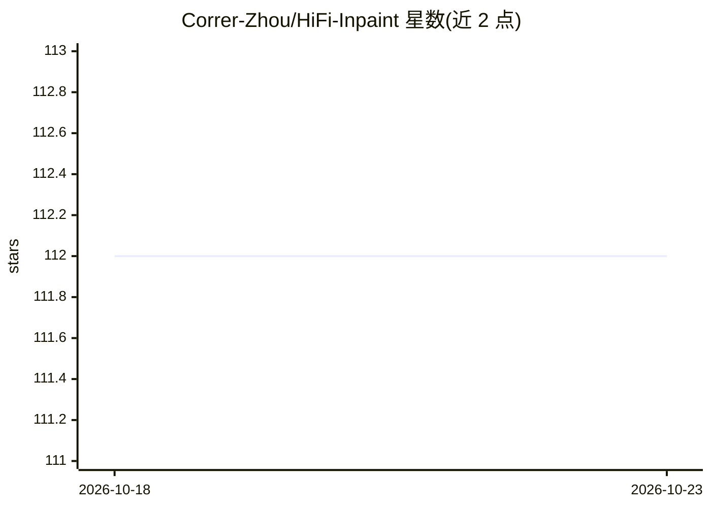

# Correr-Zhou/HiFi-Inpaint

⭐ 112 · Python · Apache-2.0 · 推送 2026-06-07 · [GitHub](https://github.com/Correr-Zhou/HiFi-Inpaint) · 组织维护 · 中文 README

**基于参考图的高保真人-商品图修复生成框架（CVPR 2026）**

论文官方实现：基于 DiT（FLUX.1-dev + LoRA）的 reference-based inpainting 框架，将商品参考图融入遮罩后的人物图，生成保留商品细节的人-商品图。提出 Shared Enhancement Attention 细化商品细粒度特征、Detail-Aware Loss 用高频图做像素级监督，并构建 HP-Image-40K 数据集。提供推理与训练代码及模型权重，支持单卡/多卡（torchrun）训练，训练日志经 Weights & Biases 跟踪，Apache 2.0 许可。

## 筛选速览

| 维度 | 判定 | 备注 |
|---|---|---|
| AI 角色 | `ai-native` | 本体是模型或模型工具 |
| 许可风险 | `permissive` | Apache-2.0 |
| 部署形态 | `None` |  |
| 模型依赖 | — | README 未给出锁定关系 |
| 硬件要求 | — | 无带数字的原话,不猜 |
| 安装摩擦 | `low` | 无编译、无系统依赖或容器化 |
| 成熟度 | — | 结构信号不足 |

## 能力要点

- DiT（FLUX.1-dev + LoRA）架构的参考图引导 inpainting
- Shared Enhancement Attention 与 Detail-Aware Loss 两个机制
- 自建 HP-Image-40K 数据集已开源
- 提供推理代码、训练代码与模型权重

## 适用场景

- 广告/电商场景生成人-商品展示图
- 复现或改进参考图引导的图像修复研究
- 用自有数据训练/微调人-商品图生成模型

## 场景标签

`图像生成` · 领域:内容生成

## 证据(README 行号)

> L27: Human-product images, which showcase the integration of humans and products, play a vital role in advertising, e-co
> L30:  <small>We propose HiFi-Inpaint , a DiT-based framework that can seamlessly integrate product reference images into

## 星数曲线

2026-10-18 112 → 2026-10-23 112（+0）

---
*卡片 v1 · prompt 1.4 · 生成 2026-10-23 · 置信度 high · 依据 README sha `63730956a0cb` · [字段定义](../../DATASET.md)*
