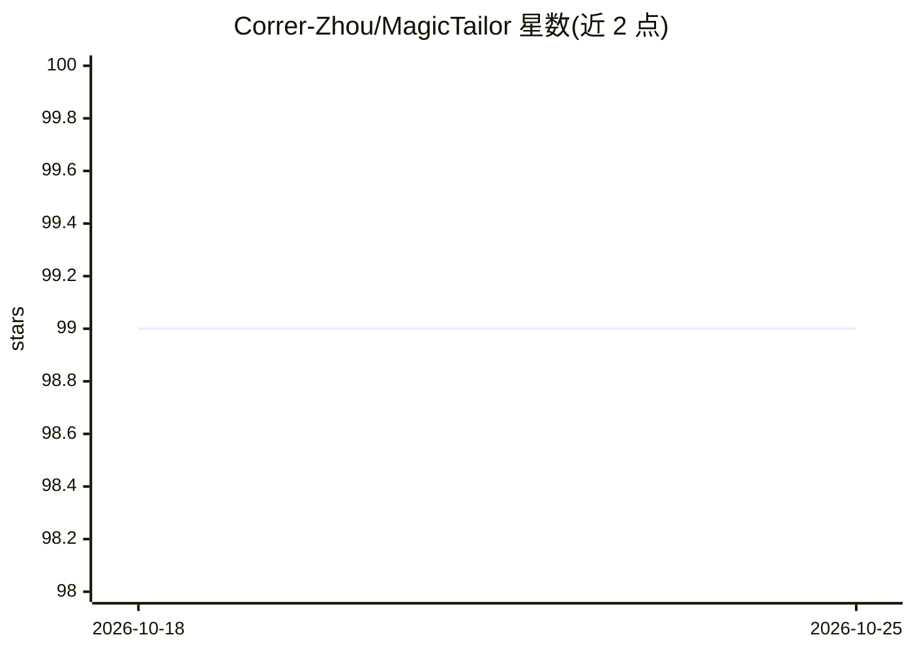

# Correr-Zhou/MagicTailor

⭐ 99 · Python · Apache-2.0 · 推送 2026-01-18 · [GitHub](https://github.com/Correr-Zhou/MagicTailor) · [官网](https://correr-zhou.github.io/MagicTailor/) · 组织维护

**文生图扩散模型组件级个性化训练框架（IJCAI 2025 论文官方实现）**

MagicTailor 是 IJCAI 2025 (Oral) 论文的官方实现，针对文生图扩散模型的组件可控个性化任务：在概念个性化时重组指定组件。框架含动态掩码退化（DM-Deg）与双流平衡（DS-Bal）两个机制，分别处理语义污染与语义不平衡问题。提供 conda 环境安装、Grounded-SAM 依赖配置、train.py 训练与 inference.py 推理流程，训练后通过占位符 token 生成图像。基于 diffusers 与 Break-A-Scene 构建，面向科研用户。

## 筛选速览

| 维度 | 判定 | 备注 |
|---|---|---|
| AI 角色 | `ai-native` | 本体是模型或模型工具 |
| 许可风险 | `permissive` | Apache-2.0 |
| 部署形态 | `library` | 以包/库形式分发 |
| 模型依赖 | — | README 未给出锁定关系 |
| 硬件要求 | — | 无带数字的原话,不猜 |
| 安装摩擦 | `medium` | 含编译或系统依赖之一 |
| 成熟度 | — | 结构信号不足 |

## 能力要点

- 提出组件可控个性化任务，重组概念中的指定组件
- DM-Deg 动态扰动不需要的视觉语义，DS-Bal 平衡语义学习
- 提供训练与推理脚本及示例数据，快速试用可跳过 Grounded-SAM 安装

## 适用场景

- 研究文生图扩散模型的组件级个性化方法
- 复现论文实验或基于示例数据快速试用
- 定制概念与组件组合（如人物+发型）生成图像

## 场景标签

`图像生成` `科研工具` `微调` · 领域:内容生成

## 证据(README 行号)

> L26: We present **MagicTailor** to enable **component-controllable personalization**, a newly formulated task aiming to 
> L29:  Recent advancements in text-to-image (T2I) diffusion models have enabled the creation of high-quality images from 

## 星数曲线

2026-10-18 99 → 2026-10-25 99（+0）

---
*卡片 v1 · prompt 1.4 · 生成 2026-10-23 · 置信度 mid · 依据 README sha `04e1e9e9b638` · [字段定义](../../DATASET.md)*
