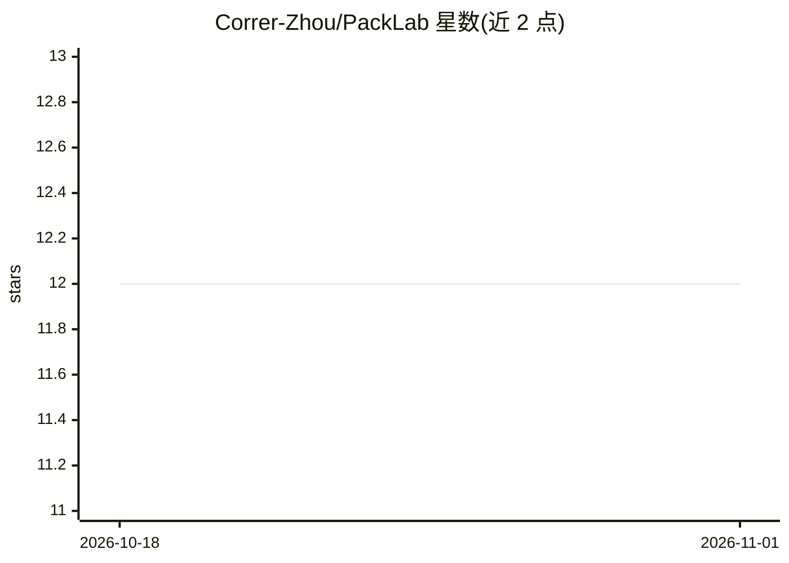

# Correr-Zhou/PackLab

⭐ 12 · Python · 推送 2026-09-23 · [GitHub](https://github.com/Correr-Zhou/PackLab) · 组织维护

**面向机器人装箱任务的多模态大模型开发、训练与评测框架**

CUHK 团队发布的机器人装箱领域 MLLM 全流程框架，含三个组件：PackLab-Suite 基于物理仿真的轨迹生成与物理结果评估平台、PackLab-VLM-9B 在物体几何与容器状态上推理选物与放置预测的 9B 专用模型、PackLab-Bench 多难度分级评测基准。训练基于 verl（锁定特定 commit）、默认 SFT 底座为 Qwen3.5-9B，支持多 GPU 并行与 OpenAI 兼容端点评测，并提供数据生成、可视化脚本与 PackData-20K 数据集。

## 筛选速览

| 维度 | 判定 | 备注 |
|---|---|---|
| AI 角色 | `ai-ecosystem` | LLM/agent 周边工具 |
| 许可风险 | `none` | — |
| 部署形态 | `None` |  |
| 模型依赖 | local-ok | 支持本地模型 |
| 硬件要求 | — | 无带数字的原话,不猜 |
| 安装摩擦 | `low` | 无编译、无系统依赖或容器化 |
| 成熟度 | — | 结构信号不足 |

## 能力要点

- 仿真平台生成装箱轨迹并评估物理结果
- PackLab-VLM-9B 专用模型推理物体选择与放置预测
- 多难度分级的标准化评测基准 PackLab-Bench
- 支持自定义数据生成与动作序列可视化回放

## 适用场景

- 训练和评测装箱任务专用的多模态大模型
- 用 PackLab-Bench 系统评估模型在不同难度下的装箱表现
- 生成自定义装箱轨迹数据构建自己的 SFT 数据集

## 场景标签

`模型评测` `多模态` `微调` · 领域:评测与运维

## 证据(README 行号)

> L15: PackLab is a comprehensive framework for developing, training, and evaluating multi-modal large language models for
> L38: The training scripts use `verl.trainer.sft_trainer`. The release was validated with `verl` commit `5a2eed1c5265841a

## 星数曲线

2026-10-18 12 → 2026-11-01 12（+0）

---
*卡片 v1 · prompt 1.4 · 生成 2026-11-01 · 置信度 high · 依据 README sha `26b0df324db8` · [字段定义](../../DATASET.md)*
