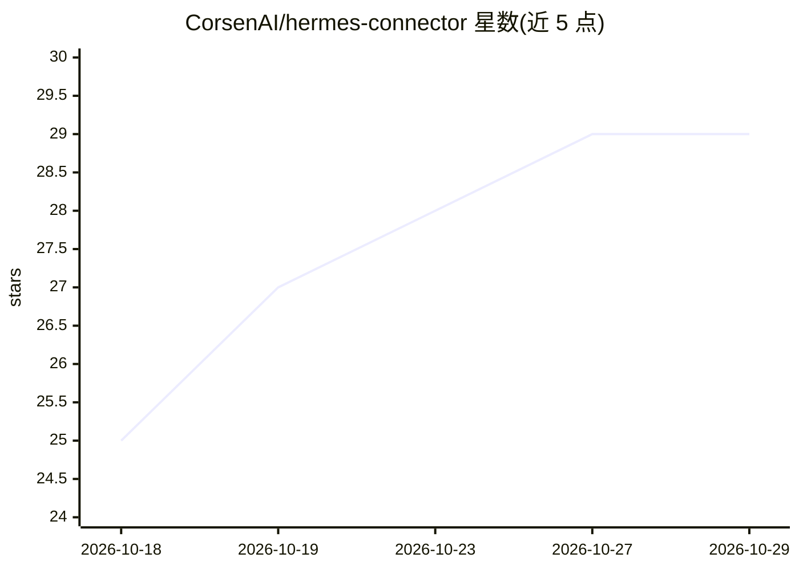

# CorsenAI/hermes-connector

⭐ 29 · Python · MIT · 推送 2026-10-26 · [GitHub](https://github.com/CorsenAI/hermes-connector) · [官网](https://corsenai.github.io/hermes-connector/) · 组织维护

**把本地 Hermes Agent 会话接入用户选定 Chrome 标签页的浏览器扩展**

Corsen AI 开发的开源 Chrome 扩展（Manifest V3），为本地安装的 Hermes Agent 提供精确的浏览器控制通道：用户在侧边栏选择 Hermes 会话并显式附加标签页后，Hermes 可读取页面、执行点击/输入/滚动等操作，未附加的标签页不可访问。由扩展、本地 companion（安装 Hermes 侧插件并运行 127.0.0.1 回环 broker）配对组成，两者版本必须完全一致。面向 Hermes Agent 用户，从 Chrome Web Store 安装，无云端中继、无遥测。

## 筛选速览

| 维度 | 判定 | 备注 |
|---|---|---|
| AI 角色 | `ai-ecosystem` | LLM/agent 周边工具 |
| 许可风险 | `permissive` | MIT |
| 部署形态 | `desktop` | 安装包/桌面程序 |
| 模型依赖 | — | README 未给出锁定关系 |
| 硬件要求 | — | 无带数字的原话,不猜 |
| 安装摩擦 | `low` | 无编译、无系统依赖或容器化 |
| 成熟度 | — | 结构信号不足 |

## 能力要点

- 侧边栏选择会话并显式附加标签页，未附加标签不可访问
- companion 在本地回环地址运行已认证 broker（版本须与扩展完全一致）
- 0.2.4 支持自动发现 Hermes Desktop 会话，无需单独打开 web dashboard
- 无中继/账号/遥测，配对密钥不外发，快照中对敏感字段做脱敏

## 适用场景

- 让本地 Hermes Agent 在我指定的浏览器标签页内读页面、点按钮、填表单
- 并行运行多个 Hermes 任务且互相隔离，各只控制各自附加的标签
- 在已登录的正常 Chrome 配置文件中让 agent 操作网站而不另开自动化浏览器

## 场景标签

`浏览器自动化` · 领域:效率与自动化

## 证据(README 行号)

> L3: Hermes Connector is an open-source Chrome browser extension for Hermes Agent
> L5: you choose. Hermes can then read and control those tabs without using a hidden
> L168: A Chrome extension cannot register browser tools directly inside a local Hermes

## 星数曲线

2026-10-18 25 → 2026-10-29 29（+4）

---
*卡片 v1 · prompt 1.4 · 生成 2026-10-26 · 置信度 high · 依据 README sha `35e9a14f2837` · [字段定义](../../DATASET.md)*
