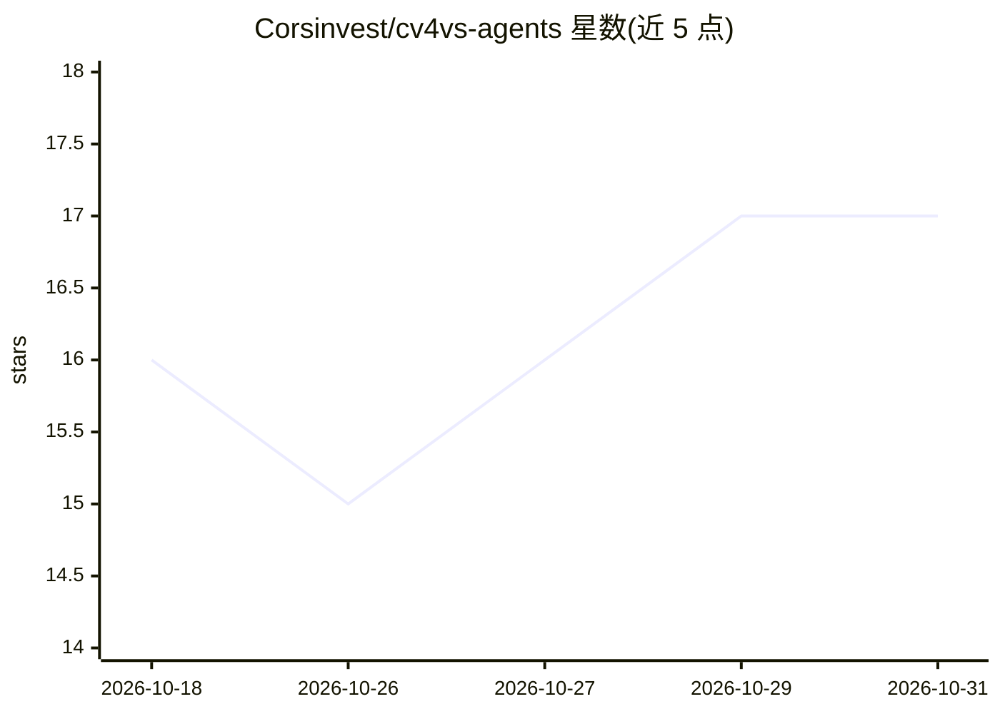

# Corsinvest/cv4vs-agents

⭐ 17 · C# · GPL-3.0 · 推送 2026-10-27 · [GitHub](https://github.com/Corsinvest/cv4vs-agents) · [官网](https://marketplace.visualstudio.com/items?itemName=Corsinvest.cv4vs-agents) · 组织维护 · 中文 README

**把 Claude Code CLI 嵌入 Visual Studio 的 IDE 扩展**

Visual Studio 2022/2026 扩展，将 Claude Code CLI 接入 IDE：提供 WebView2 聊天窗格与 ConPTY 交互终端，通过 80 个 MCP 工具把编辑器导航、诊断、构建、Test Explorer 与实时调试器交给 agent。它驱动真实 claude.exe（经 npm/winget 单独安装，不随扩展捆绑），读写 CLI 自身会话存储，与 VS Code、终端共用会话；支持任意 Anthropic 兼容供应商（GLM、DeepSeek、OpenRouter、Ollama 等）经环境变量配置。采用延迟加载设计，仅在有需要时启动服务与读取数据。

## 筛选速览

| 维度 | 判定 | 备注 |
|---|---|---|
| AI 角色 | `ai-ecosystem` | LLM/agent 周边工具 |
| 许可风险 | `viral` | GPL-3.0 |
| 部署形态 | `desktop` | 安装包/桌面程序 |
| 模型依赖 | locked-api |  |
| 硬件要求 | — | 无带数字的原话,不猜 |
| 安装摩擦 | `low` | 无编译、无系统依赖或容器化 |
| 成熟度 | — | 结构信号不足 |

## 能力要点

- 80 个 MCP 工具：导航、引用、重命名、诊断、构建、Test Explorer 与实时调试器
- 聊天窗格与真实 CLI 终端共用同一会话存储，兼容 VS Code
- 断点异常时一键向 agent 提问，读取实时调用栈与局部变量
- /rewind 恢复会话任意消息前的文件状态，保留对话

## 适用场景

- 在 Visual Studio 内直接与 Claude Code 对话并让它操作 IDE
- 调试断点处让 agent 读取实时堆栈与变量分析异常
- 在扩展内切换 GLM/DeepSeek/OpenRouter/Ollama 等 Anthropic 兼容供应商

## 场景标签

`编码 Agent` · 领域:编码与开发

## 证据(README 行号)

> L14: A Visual Studio 2022 / 2026 extension that brings the **Claude Code** CLI inside the IDE: a rich
> L89: - **80 MCP tools**: Visual Studio's own navigation, references, rename,
> L120: - **Any Anthropic-compatible provider**: profiles inject per-pane

## 星数曲线

2026-10-18 16 → 2026-10-31 17（+1）

---
*卡片 v1 · prompt 1.4 · 生成 2026-10-30 · 置信度 mid · 依据 README sha `c58e9b71d8fc` · [字段定义](../../DATASET.md)*
