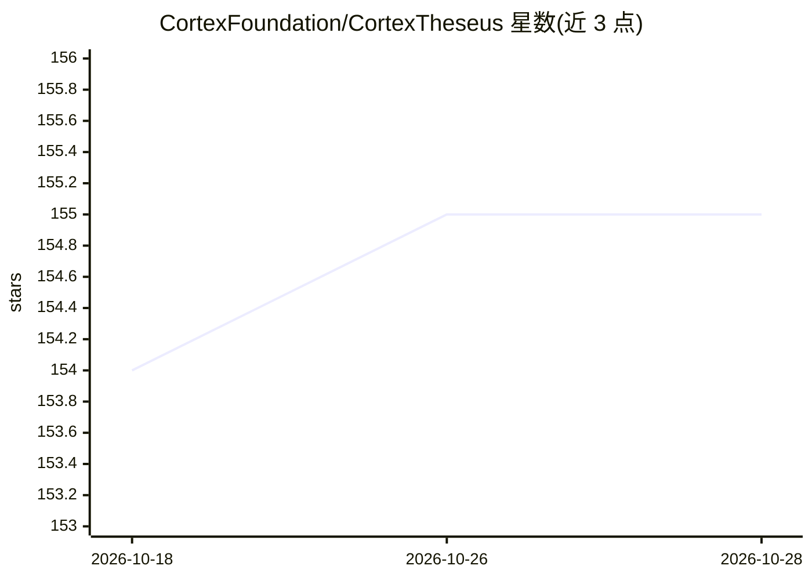

# CortexFoundation/CortexTheseus

⭐ 155 · Go · LGPL-3.0 · 推送 2026-07-31 · [GitHub](https://github.com/CortexFoundation/CortexTheseus) · [官网](https://www.cortexlabs.ai) · 组织维护

**Cortex 区块链全节点官方 Golang 实现，链上跑 AI 推理**

Cortex（AI on Blockchain）区块链的官方 Go 语言全节点实现。通过内嵌 CVM runtime 插件（libcvm_runtime.so）在虚拟机中执行模型推理，配套 torrentfs 文件存储、Cuckoo cycle PoW、Rosetta 接口与 Docker 等周边仓库。编译需 Go 1.20+、gcc/g++、cmake，GPU 环境需 CUDA（可选）；仅支持 x64 架构，建议 8G+ 内存。编译后以 cortex 命令启动主网或 Bernard 测试网节点。

## 筛选速览

| 维度 | 判定 | 备注 |
|---|---|---|
| AI 角色 | `ai-ecosystem` | LLM/agent 周边工具 |
| 许可风险 | `viral` | LGPL-3.0 |
| 部署形态 | `None` |  |
| 模型依赖 | — | README 未给出锁定关系 |
| 硬件要求 | — | 无带数字的原话,不猜 |
| 安装摩擦 | `high` | 编译与系统依赖俱全 |
| 成熟度 | — | 结构信号不足 |

## 能力要点

- 官方 Golang 全节点实现，含 CVM runtime（AI container）插件加载校验
- 通过链上虚拟机执行 AI 推理，配套推理与文件存储 API 封装仓库
- 配套 Cuckoo cycle PoW、torrentfs 存储、Rosetta、Docker 等子项目

## 适用场景

- 运行 Cortex 主网或 Bernard 测试网全节点
- 参与基于 Cuckoo cycle 的 PoW 挖矿（配合 solution 仓库）
- 通过 Rosetta 接口对接区块链数据服务

## 场景标签

`推理引擎` · 领域:训练与推理

## 证据(README 行号)

> L2: ### CVM runtime (AI container)
> L21: https://github.com/CortexFoundation/inference
> L50: Cortex node is developed in Ubuntu 18.04 x64 + CUDA 9.2 + NVIDIA Driver 396.37 environment, with CUDA Compute capab

## 星数曲线

2026-10-18 154 → 2026-10-28 155（+1）

---
*卡片 v1 · prompt 1.4 · 生成 2026-10-22 · 置信度 high · 依据 README sha `fba3034c1c24` · [字段定义](../../DATASET.md)*
