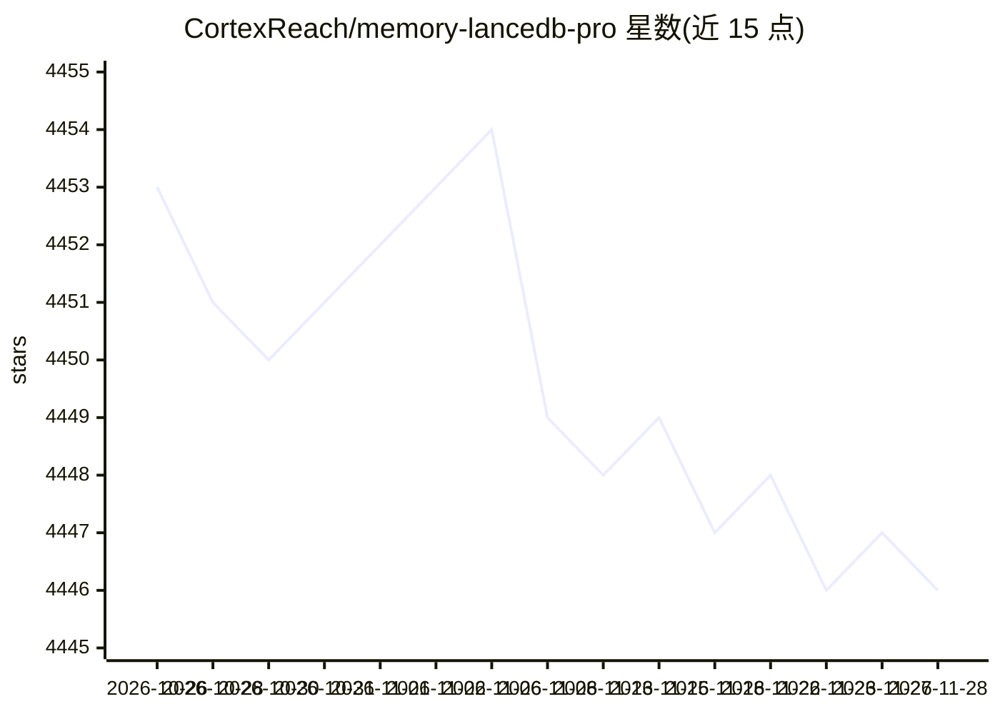

# CortexReach/memory-lancedb-pro

⭐ 4,446 · JavaScript · 推送 2026-11-26 · [GitHub](https://github.com/CortexReach/memory-lancedb-pro) · [官网](https://www.bilibili.com/video/BV1zUf2BGEgn/) · 个人维护 · 中文 README

**为 OpenClaw Agent 提供长期记忆的 LanceDB 插件**

面向 OpenClaw Agent 的记忆插件，以 LanceDB 为向量存储，自动从对话中捕获偏好、决策与项目上下文，并在后续会话中自动召回注入。机制包括 LLM 驱动的 6 类记忆分类、Weibull 衰减遗忘模型、向量+BM25 混合检索与 cross-encoder 重排、按 Agent/用户/项目的多范围隔离，并提供 CLI 备份、迁移、导出导入等管理工具。要求 OpenClaw 2026.3+，CPU 需支持 AVX 指令。

## 筛选速览

| 维度 | 判定 | 备注 |
|---|---|---|
| AI 角色 | `ai-ecosystem` | LLM/agent 周边工具 |
| 许可风险 | `permissive` | — |
| 部署形态 | `library` | 以包/库形式分发 |
| 模型依赖 | local-ok | 支持本地模型 |
| 硬件要求 | — | 无带数字的原话,不猜 |
| 安装摩擦 | `low` | 无编译、无系统依赖或容器化 |
| 成熟度 | — | 结构信号不足 |

## 能力要点

- 自动捕获 + LLM 6 类记忆分类（profiles/preferences/entities/events/cases/patterns）
- 混合检索：Vector + BM25 融合 cross-encoder 重排
- Weibull 衰减的智能遗忘与多范围记忆隔离
- CLI 工具链：备份、迁移、升级、导出/导入

## 适用场景

- 让 Agent 记住我的编码偏好并在新会话自动应用
- 查询团队过去讨论过的技术选型决策
- 多个 Agent/项目各自维护独立的记忆边界

## 场景标签

`Agent 记忆` · 领域:Agent 开发

## 证据(README 行号)

> L9: A LanceDB-backed OpenClaw memory plugin that stores preferences, decisions, and project context, then auto-recalls t
> L28: **memory-lancedb-pro** is a production-grade long-term memory plugin for OpenClaw that turns your agent into an **A
> L60: |**Any Provider**|OpenAI, Jina, Gemini, Ollama, or any OpenAI-compatible API|

## 星数曲线

2026-10-26 4,453 → 2026-11-28 4,446（-7）

---
*卡片 v1 · prompt 1.4 · 生成 2026-11-27 · 置信度 high · 依据 README sha `4da9bedf5076` · [字段定义](../../DATASET.md)*
