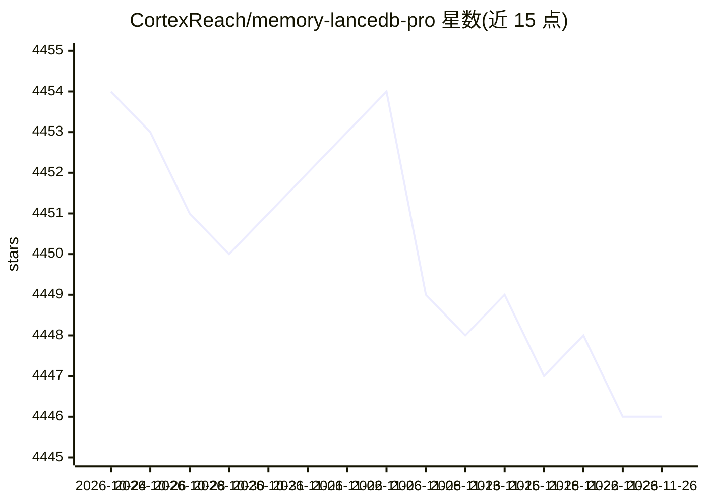

# CortexReach/memory-lancedb-pro

⭐ 4,446 · JavaScript · 推送 2026-11-19 · [GitHub](https://github.com/CortexReach/memory-lancedb-pro) · [官网](https://www.bilibili.com/video/BV1iWwtztEQf/) · 个人维护 · 中文 README

**OpenClaw agent 的长期记忆插件：自动捕获并按需召回上下文**

基于 LanceDB 的 OpenClaw 记忆插件，自动从对话中捕获偏好、决策与项目上下文，按 6 类做 LLM 抽取，用 Weibull 衰减模型让噪声记忆自然淡出；检索采用向量+BM25 混合并经 cross-encoder 重排，回复前自动注入相关记忆，支持按 agent/用户/项目隔离记忆边界。提供 CLI、备份、迁移、导出导入等管理工具，需 CPU 支持 AVX 指令。面向使用 OpenClaw 的 agent 用户。

## 筛选速览

| 维度 | 判定 | 备注 |
|---|---|---|
| AI 角色 | `ai-ecosystem` | LLM/agent 周边工具 |
| 许可风险 | `permissive` | — |
| 部署形态 | `library` | 以包/库形式分发 |
| 模型依赖 | local-ok | 支持本地模型 |
| 硬件要求 | — | 无带数字的原话,不猜 |
| 安装摩擦 | `low` | 无编译、无系统依赖或容器化 |
| 成熟度 | — | 结构信号不足 |

## 能力要点

- 向量+BM25 混合检索，cross-encoder 重排
- LLM 6 类抽取与 Weibull 衰减的智能遗忘
- 多作用域隔离（per-agent/per-user/per-project）
- CLI、备份、迁移、导出导入完整工具链

## 适用场景

- 让 agent 跨会话记住我的编码偏好和项目决策
- 多个 agent、多个项目之间隔离各自记忆
- 生产环境中对 agent 记忆做备份和迁移

## 场景标签

`Agent 记忆` · 领域:Agent 开发

## 证据(README 行号)

> L9: A LanceDB-backed OpenClaw memory plugin that stores preferences, decisions, and project context, then auto-recalls t
> L59: |**Multi-Scope Isolation**|Per-agent, per-user, per-project memory boundaries|

## 星数曲线

2026-10-24 4,454 → 2026-11-26 4,446（-8）

---
*卡片 v1 · prompt 1.4 · 生成 2026-11-22 · 置信度 high · 依据 README sha `d387e2ff4ec1` · [字段定义](../../DATASET.md)*
