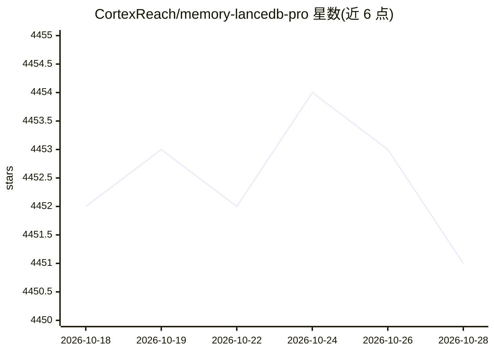

# CortexReach/memory-lancedb-pro

⭐ 4,451 · JavaScript · 推送 2026-10-21 · [GitHub](https://github.com/CortexReach/memory-lancedb-pro) · [官网](https://youtu.be/bhuGrjuCM_g) · 组织维护 · 中文 README

**OpenClaw 插件：为 agent 提供 LanceDB 长期记忆与混合检索**

面向 OpenClaw 2026.3+ 的记忆插件（npm 分发）：自动从对话捕获偏好、决策与项目上下文（LLM 六类分类），通过 before_prompt_build 钩子在回复前注入相关记忆；检索采用向量+BM25 混合并经交叉编码器重排，记忆按 agent/用户/项目隔离，并用 Weibull 衰减模型让噪声淡出。以 MEMORY.md 等文件为事实源，LanceDB 作为语义索引提供带路径与行号引用的召回。嵌入/重排支持 OpenAI、Jina、Gemini、Ollama 等。限制：CPU 需 AVX（部分构建需 AVX2），当前版本为 beta。

## 筛选速览

| 维度 | 判定 | 备注 |
|---|---|---|
| AI 角色 | `ai-ecosystem` | LLM/agent 周边工具 |
| 许可风险 | `permissive` | — |
| 部署形态 | `library` | 以包/库形式分发 |
| 模型依赖 | local-ok | 支持本地模型 |
| 硬件要求 | — | 无带数字的原话,不猜 |
| 安装摩擦 | `low` | 无编译、无系统依赖或容器化 |
| 成熟度 | `idea` | |

## 能力要点

- 自动捕获 + LLM 六类记忆抽取，无需手动 memory_store
- 向量 + BM25 混合检索，交叉编码器重排
- 按 agent/用户/项目多作用域隔离，Weibull 衰减决定记忆留存
- 提供 CLI 备份、导出导入、迁移升级工具与一键安装脚本

## 适用场景

- 让 OpenClaw agent 跨会话记住我的编码偏好与历史决策
- 为多 agent/多项目环境维护隔离的长期记忆
- 本地零 API 成本部署（Ollama）长期记忆

## 场景标签

`Agent 记忆` `RAG` · 领域:Agent 开发

## 证据(README 行号)

> L7: A LanceDB-backed OpenClaw memory plugin that stores preferences, decisions, and project context, then auto-recalls t
> L126: - `api.registerMemoryCapability({ runtime, promptBuilder, flushPlanResolver, publicArtifacts })`

## 星数曲线

2026-10-18 4,452 → 2026-10-28 4,451（-1）

---
*卡片 v1 · prompt 1.4 · 生成 2026-10-21 · 置信度 high · 依据 README sha `08349b52f268` · [字段定义](../../DATASET.md)*
