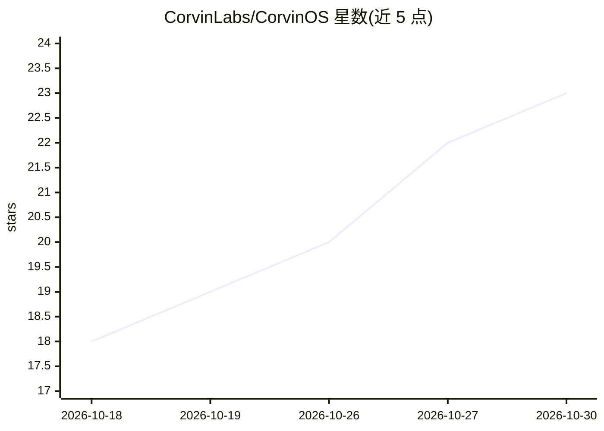

# CorvinLabs/CorvinOS

⭐ 23 · Python · Apache-2.0 · 推送 2026-10-29 · [GitHub](https://github.com/CorvinLabs/CorvinOS) · [官网](https://corvin-labs.com, https://www.youtube.com/@Corvin-Labs) · 组织维护

**自托管的 agentic 操作系统：运行并治理团队的 AI 代理**

面向构建者的自托管代理运行平台：用户自带代理（默认 Claude Code，也可用 Codex、OpenCode、Copilot CLI），系统将其置于合规绊线之后，按轮次将请求路由到不同档位的模型以降低 token 开销，用 fail-closed 门控约束代理可触及的资源，记录全部对话并将每一步写入按租户的哈希链审计日志。支持七种聊天应用、语音、Web 控制台等接口接入，宣称以架构满足 GDPR 与 EU AI Act。通过 git clone 加 install 脚本安装（明确声明无 PyPI 包），也提供 Claude Code 插件市场方式安装；跨 Linux/macOS/Windows，控制台本地运行于 127.0.0.1:8765。

## 筛选速览

| 维度 | 判定 | 备注 |
|---|---|---|
| AI 角色 | `ai-ecosystem` | LLM/agent 周边工具 |
| 许可风险 | `permissive` | Apache-2.0 |
| 部署形态 | `library` | 以包/库形式分发 |
| 模型依赖 | locked-api |  |
| 硬件要求 | — | 无带数字的原话,不猜 |
| 安装摩擦 | `medium` | 含编译或系统依赖之一 |
| 成熟度 | — | 结构信号不足 |

## 能力要点

- 按轮次三档模型路由并在审计链中记录 token 花费，提供节省核对脚本
- fail-closed 门控与每租户哈希链审计日志
- 通过 Discord、Telegram、WhatsApp、Slack、Email 等七种聊天应用及语音、Web 控制台接入
- 自带 Claude Code 插件市场，可在 Claude Code 内安装/更新整个系统

## 适用场景

- 团队将 Claude Code 等代理接入聊天渠道并统一治理
- 需要可审计的 AI 操作记录以满足 GDPR/EU AI Act 合规
- 通过模型路由降低多代理工作流的 token 成本

## 场景标签

`模型网关` `Agent 框架` `LLM 可观测性` · 领域:Agent 开发

## 证据(README 行号)

> L196: You bring the agent — **Claude Code** by default, or Codex, OpenCode or Copilot CLI. CorvinOS boots it behind a co
> L192: **CorvinOS is the system layer that fixes these around the agent you already use.**
> L74: 3. Installs Claude Code if it is missing. If you are at a terminal it also starts the browser login and waits up to

## 星数曲线

2026-10-18 18 → 2026-10-30 23（+5）

---
*卡片 v1 · prompt 1.4 · 生成 2026-10-28 · 置信度 mid · 依据 README sha `7dad1433dbcb` · [字段定义](../../DATASET.md)*
