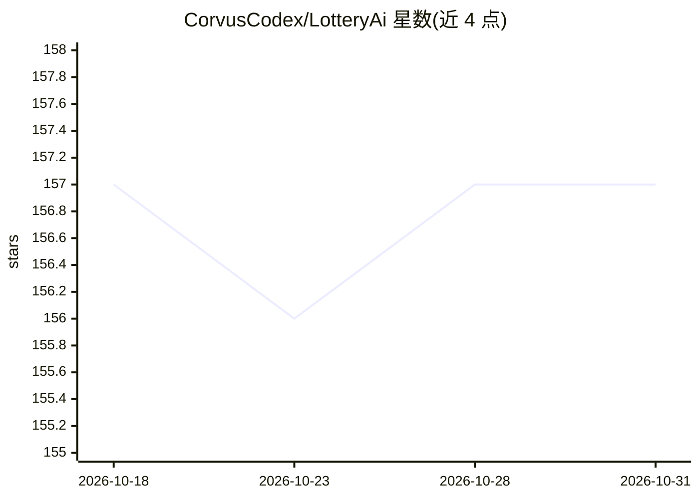

# CorvusCodex/LotteryAi

⭐ 157 · Python · MIT · 推送 2026-05-04 · [GitHub](https://github.com/CorvusCodex/LotteryAi) · 个人维护

**用机器学习预测彩票号码的 Python 脚本，附带付费预测服务**

单文件 Python 脚本 LotteryAi.py：读取 CSV 格式的历史开奖数据，基于 numpy/tensorflow/keras 训练模型并在控制台输出预测号码组合（前 10 行）与 ASCII 图形。README 声明针对 CUDA、Threadripper 与多 GPU 优化。仓库同时推广 Telegram 机器人与 Buy Me a Coffee 上的付费预测报告、编译版独立应用及数据集销售，代码声明仅供教育与研究用途，且声明彩票结果本身随机、预测无准确性保证。

## 筛选速览

| 维度 | 判定 | 备注 |
|---|---|---|
| AI 角色 | `ai-native` | 本体是模型或模型工具 |
| 许可风险 | `permissive` | MIT |
| 部署形态 | `library` | 以包/库形式分发 |
| 模型依赖 | — | README 未给出锁定关系 |
| 硬件要求 | — | 无带数字的原话,不猜 |
| 安装摩擦 | `medium` | 含编译或系统依赖之一 |
| 成熟度 | — | 结构信号不足 |

## 能力要点

- 读取 CSV 历史开奖数据训练模型并生成预测号码
- 依赖 numpy/tensorflow/keras，pip 安装依赖后运行脚本
- README 声明针对 CUDA、Threadripper 与多 GPU 优化
- 附带 Telegram 付费预测机器人与付费报告/独立应用销售渠道

## 适用场景

- 我想用自己的历史开奖数据训练模型并生成号码预测
- 我想研究彩票预测的机器学习实现方式

## 场景标签

 · 领域:博彩预测/机器学习脚本

## 证据(README 行号)

> L6: LotteryAi is a advanced lottery prediction artificial intelligence that uses state-of-the-art machine learning to pr
> L53: Once you have the data file, you can run the `LotteryAi.py` script to train the model and generate predictions. The

## 星数曲线

2026-10-18 157 → 2026-10-31 157（+0）

---
*卡片 v1 · prompt 1.4 · 生成 2026-10-22 · 置信度 mid · 依据 README sha `d61cea652d7c` · [字段定义](../../DATASET.md)*
