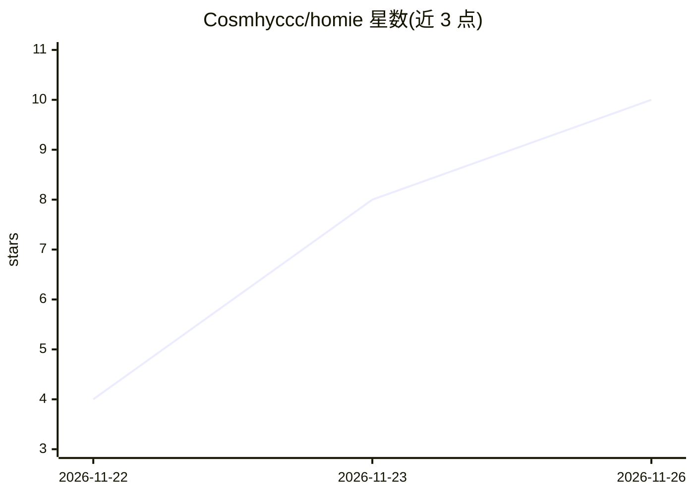

# Cosmhyccc/homie

⭐ 10 · Swift · NOASSERTION · 推送 2026-11-24 · [GitHub](https://github.com/Cosmhyccc/homie) · [官网](https://homie-mac.vercel.app) · 个人维护

**Mac 刘海中的本地离线语音助手：按住说话即完成操作**

运行在 Apple silicon Mac 上的语音助手，驻留刘海区域，按 fn 键说话即可设置定时器、播放音乐、读取日历、切换深色模式、圈选屏幕内容标注、显示 3D 模型并语音回复。采用分层加速机制：约 600 行模式匹配的「instant lane」不经模型直接执行常用指令（约 0.4 秒），复杂请求交给本地 Qwen 3.5 模型（llama.cpp 推理），辅以提示缓存落盘、提前起跑等延迟优化。语音识别、OCR、TTS 均在本机运行，飞行模式下可用。8 GB 内存机型自动降级为 2B 模型。

## 筛选速览

| 维度 | 判定 | 备注 |
|---|---|---|
| AI 角色 | `ai-native` | 本体是模型或模型工具 |
| 许可风险 | `none` | NOASSERTION |
| 部署形态 | `desktop` | 安装包/桌面程序 |
| 模型依赖 | — | README 未给出锁定关系 |
| 硬件要求 | — | 无带数字的原话,不猜 |
| 安装摩擦 | `low` | 无编译、无系统依赖或容器化 |
| 成熟度 | — | 结构信号不足 |

## 能力要点

- 「instant lane」模式匹配免模型执行常用指令，约 0.4 秒响应
- 提示缓存持久化：问题只需追加约 45 token 而非重读 3,700 token 提示
- 屏幕圈选标注：模型只输出文字，OCR 与 Accessibility 树定位坐标
- 全部计算在本机，语音识别/OCR/TTS 不出电脑，飞行模式可用

## 适用场景

- 按 fn 说话控制 Mac 的定时器、音乐、日历和系统设置
- 圈选屏幕内容让助手标注或解释
- 需要数据不出本机的隐私敏感语音助手场景

## 场景标签

`语音 Agent` · 领域:对话与助手

## 证据(README 行号)

> L5: **A voice buddy in your Mac's notch that runs entirely on your Mac.**
> L6: Press fn , talk. It sets timers, plays music, reads your calendar, flips dark mode, looks at what you circle on scre
> L74: Requires an **Apple silicon** Mac (M1 or newer) on **macOS 26+**.

## 星数曲线

2026-11-22 4 → 2026-11-26 10（+6）

---
*卡片 v1 · prompt 1.4 · 生成 2026-11-22 · 置信度 high · 依据 README sha `f968114db69d` · [字段定义](../../DATASET.md)*
