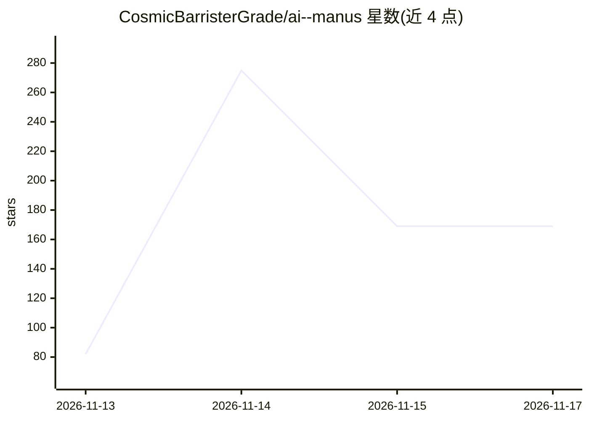

# CosmicBarristerGrade/ai--manus

⭐ 169 · Apache-2.0 · 推送 2026-11-15 · [GitHub](https://github.com/CosmicBarristerGrade/ai--manus) · 个人维护

**面向日常小任务的自主 AI Agent：代用户执行代码与控制浏览器**

定位为家用、学习与轻办公场景的自主 AI 代理：接收自然语言指令后自行编写并执行脚本、打开网页、填表与收集信息，可串联代码与浏览器完成多步骤任务，最少监督下运行。README 说明其支持跨会话记住工作流模式、后台待命，并给出最低配置表（双核 CPU、4GB 内存）与六步上手流程。全文为介绍性内容，未提供安装命令、源码结构或 API/模型接入方式等技术细节。

## 筛选速览

| 维度 | 判定 | 备注 |
|---|---|---|
| AI 角色 | `ai-native` | 本体是模型或模型工具 |
| 许可风险 | `permissive` | Apache-2.0 |
| 部署形态 | `None` |  |
| 模型依赖 | — | README 未给出锁定关系 |
| 硬件要求 | — | 无带数字的原话,不猜 |
| 安装摩擦 | `low` | 无编译、无系统依赖或容器化 |
| 成熟度 | — | 结构信号不足 |

## 能力要点

- 自主执行代码与脚本完成多步骤任务
- 浏览器控制：导航网页、填写表单、收集信息
- 代码与浏览器操作可在同一任务流中衔接
- 面向家庭、学习与轻办公的小规模场景

## 适用场景

- 让代理代为查网页、填表单、整理资料
- 运行小脚本与快速实验而不搭建完整环境
- 把重复性的日常小任务委托给后台代理

## 场景标签

`浏览器自动化` `AI 助手` · 领域:效率与自动化

## 证据(README 行号)

> L10: - **Autonomous Code Execution:** Manus AI agent runs code on its own to complete tasks, so you can focus on decisio
> L18: Manus is an autonomous AI agent designed to run code and control a browser on your behalf. Instead of acting like a

## 星数曲线

2026-11-13 82 → 2026-11-17 169（+87）

---
*卡片 v1 · prompt 1.4 · 生成 2026-11-17 · 置信度 low · 依据 README sha `a3d88e202bf0` · [字段定义](../../DATASET.md)*
