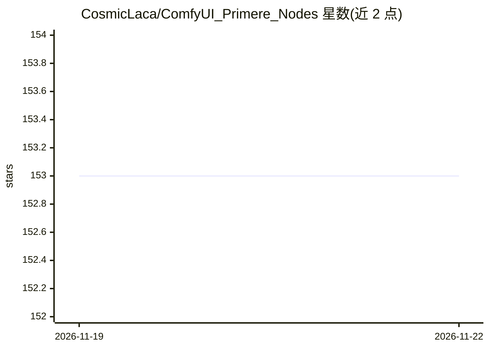

# CosmicLaca/ComfyUI_Primere_Nodes

⭐ 153 · Python · GPL-3.0 · 推送 2026-06-23 · [GitHub](https://github.com/CosmicLaca/ComfyUI_Primere_Nodes) · 个人维护

**ComfyUI 全系统节点包：按模型架构自动配置生图参数**

面向 ComfyUI 的节点包，围绕中央编排器 Primiere Model Control 组织：读取所选 checkpoint 后自动加载按模型保存的 JSON 配置（采样器、CFG、步数、VAE、CLIP、编码器、LoRA、refiner），并向下游节点分发 control_data。支持 SD1/SDXL/Flux/Hunyuan 等 25+ 模型架构，并自动移除不兼容的网络标签。提供 Minimal、Basic、Basic Production、Basic Production Plus 四套示例工作流，覆盖提示词管理、后处理、分部位细化与美学评分筛选。需先更新 ComfyUI 核心，且依赖第三方节点包 ComfyUI_ExtraModels；README 手册由 AI 撰写，仍在开发中。

## 筛选速览

| 维度 | 判定 | 备注 |
|---|---|---|
| AI 角色 | `ai-native` | 本体是模型或模型工具 |
| 许可风险 | `viral` | GPL-3.0 |
| 部署形态 | `None` |  |
| 模型依赖 | — | README 未给出锁定关系 |
| 硬件要求 | — | 无带数字的原话,不猜 |
| 安装摩擦 | `low` | 无编译、无系统依赖或容器化 |
| 成熟度 | `idea` | |

## 能力要点

- 中央编排器按 checkpoint 自动加载并分发模型参数配置
- 支持 SD1、SDXL、Flux、Hunyuan 等 25+ 模型架构及不兼容 LoRA 自动清理
- 内置 LLM 提示词增强、美学评分与超阈值选择性保存
- 四套分级工作流（Minimal 至 Production Plus）随附于 Workflow 文件夹

## 适用场景

- 在多个扩散模型架构间切换而无需手工调参
- 批量生成时按美学评分自动筛选产出图片
- 对人脸、眼睛、嘴、手做分区 refiner 细化

## 场景标签

`图像生成` `图像视频处理` · 领域:内容生成

## 证据(README 行号)

> L24: Primere Nodes is not a collection of individual utility nodes. It's a **consistent full-system solution** architect
> L56: **Central Orchestrator:** **Primiere Model Control** node reads selected checkpoint, auto-loads saved settings (sam

## 星数曲线

2026-11-19 153 → 2026-11-22 153（+0）

---
*卡片 v1 · prompt 1.4 · 生成 2026-11-19 · 置信度 high · 依据 README sha `221302eed8aa` · [字段定义](../../DATASET.md)*
