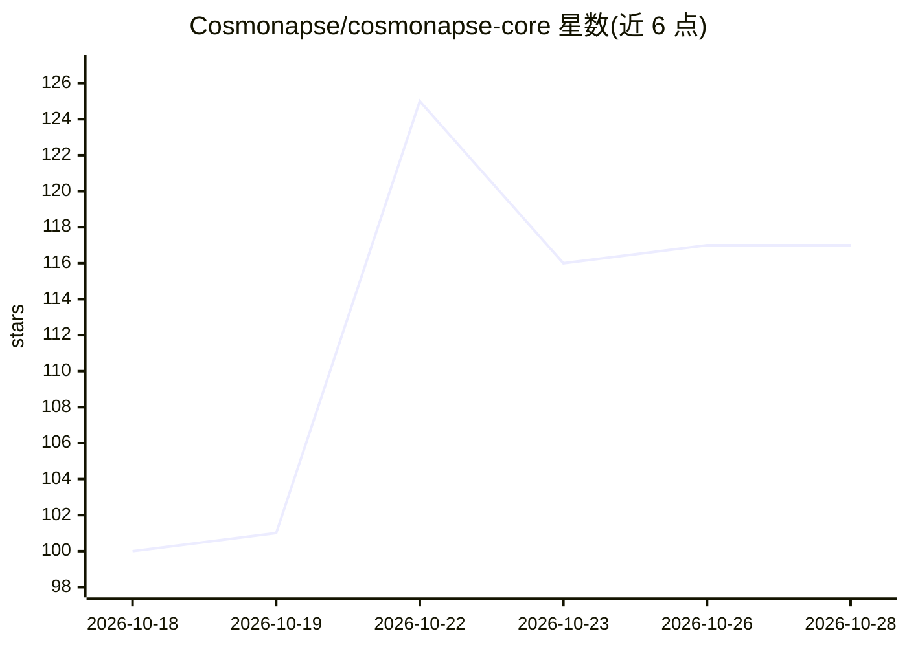

# Cosmonapse/cosmonapse-core

⭐ 118 · Python · Apache-2.0 · 推送 2026-10-28 · [GitHub](https://github.com/Cosmonapse/cosmonapse-core) · [官网](https://cosmonapse.com) · 组织维护

**事件驱动的分布式 AI agent 运行时：以信号总线替代中央编排**

开源协议与 Python SDK 套件（含 cosmo CLI、Genesis 可视化设计器、Prism 观测面板），用类型化 Signal 信封在一条总线（Synapse）上连接 Neuron（agent）、Engram（共享记忆）、Effector（工具）、Receptor（入口）四类参与者，取消 supervisor 循环与图声明。传输层可插拔：内存、TCP broker、NATS、Kafka；每个 Signal 自带 trace 与因果 id，human-in-the-loop 以 CLARIFICATION/PERMISSION 信号实现。Neuron 工厂可包装 OpenAI、Anthropic、HuggingFace、Groq、Ollama 或 MCP server 为统一签名。

## 筛选速览

| 维度 | 判定 | 备注 |
|---|---|---|
| AI 角色 | `ai-ecosystem` | LLM/agent 周边工具 |
| 许可风险 | `permissive` | Apache-2.0 |
| 部署形态 | `library` | 以包/库形式分发 |
| 模型依赖 | local-ok | 支持本地模型 |
| 硬件要求 | — | 无带数字的原话,不猜 |
| 安装摩擦 | `low` | 无编译、无系统依赖或容器化 |
| 成熟度 | — | 结构信号不足 |

## 能力要点

- 类型化 Signal 信封协议，无中央编排器，每个 Signal 自带 trace_id 与 parent_id
- Genesis 画布设计器通过 AST 写入并编辑真实模块，随 wheel 一起分发
- Prism 观测面：五视图（实时图、执行图、因果树、原始记录、指标）
- 传输可插拔：内存 / TCP broker / NATS / Kafka，扩展 extras 支持 Postgres 与 FastAPI Receptor

## 适用场景

- 构建并发、分布式的多 agent 系统，避免中央 supervisor 循环
- 在可视化画布上设计与编辑 agent 系统并直接运行
- 追踪 agent 运行的因果链路与工具调用过程
- 为 agent 系统加入人机协同的澄清与权限信号

## 场景标签

`多智能体` `Agent 框架` `Agent 记忆` · 领域:Agent 开发

## 证据(README 行号)

> L19: Cosmonapse models a multi-agent system on a nervous system rather than a supervisor. Components emit **Signals** an
> L37: |**Core**|The open protocol, the Python SDK and the `cosmo` CLI. Stands on its own and always will.|`pip install co
> L139: |**Dendrite**|Synapse-side connector|The only component that touches the Synapse. Hosts Axons, emits `REGISTER` / 

## 星数曲线

2026-10-18 100 → 2026-10-28 117（+17）

---
*卡片 v1 · prompt 1.4 · 生成 2026-10-23 · 置信度 high · 依据 README sha `599259db3ce8` · [字段定义](../../DATASET.md)*
