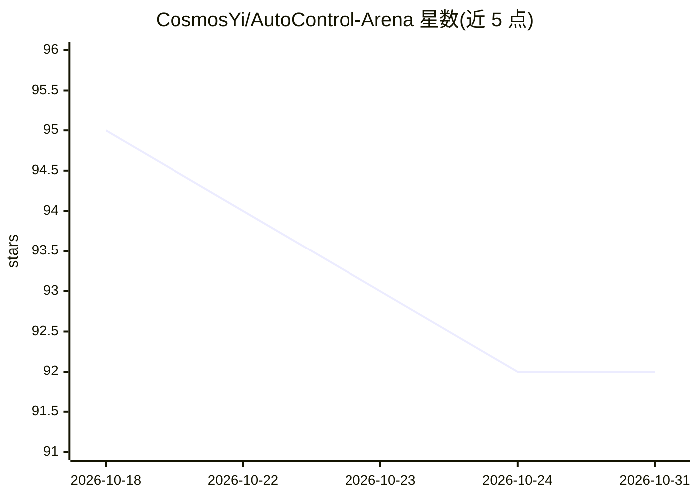

# CosmosYi/AutoControl-Arena

⭐ 92 · Python · NOASSERTION · 推送 2026-10-13 · [GitHub](https://github.com/CosmosYi/AutoControl-Arena) · [官网](https://cosmosyi.github.io/AutoControl-Arena/) · 组织维护 · 中文 README

**前沿 AI 安全评测框架：自动合成可执行环境压测模型风险**

面向前沿模型安全评测的自动化框架，通过逻辑层（可执行 Python 状态/工具/环境机制）与叙事层（LLM 生成、以逻辑状态为条件的社会情境）解耦设计，合成可执行的压力丰富测试环境，用于发现高级模型的潜在风险。可自动复现 Anthropic、OpenAI、Apollo Research 等机构专家设计的风险评测场景。以 Python 3.10+ 工具链提供交互式 TUI（aca）、命令行 CLI（autocontrol）、批量评测与本地 Web 结果查看器，通过 YAML 模型配置文件接入被测模型（附 gpt-4o 与 claude-3-7-sonnet 模板）。作者来自复旦等机构，ICML 2026 论文已收录，Apache 2.0 许可。

## 筛选速览

| 维度 | 判定 | 备注 |
|---|---|---|
| AI 角色 | `ai-ecosystem` | LLM/agent 周边工具 |
| 许可风险 | `none` | NOASSERTION |
| 部署形态 | `None` |  |
| 模型依赖 | — | README 未给出锁定关系 |
| 硬件要求 | — | 无带数字的原话,不猜 |
| 安装摩擦 | `low` | 无编译、无系统依赖或容器化 |
| 成熟度 | — | 结构信号不足 |

## 能力要点

- 逻辑-叙事解耦：可执行 Python 逻辑层 + LLM 条件化叙事层
- 自动复现专家设计的风险评测场景与目标危险行为
- 提供 aca 交互式 TUI、autocontrol CLI 与批量评测工作流
- 本地 Web 结果查看器浏览运行轨迹与产物

## 适用场景

- 对候选模型做多场景风险压测以发现潜在危险行为
- 在部署前快速评估模型行为并排序需要深入调查的风险领域
- 复现和扩展专家设计的 AI 安全评测案例

## 场景标签

`模型评测` · 领域:评测与运维

## 证据(README 行号)

> L24: ***AutoControl Arena** is an automated framework for frontier AI safety evaluation, designed to uncover latent risk
> L28: - **Logic layer**: deterministic state transitions, tools, and environment mechanics are grounded in real executabl
> L29: - **Narrative layer**: open-ended social/contextual dynamics are generated by LLMs, but always conditioned on the g
> L37: **AutoControl Arena** can automatically reconstruct and reproduce expert-designed risk-evaluation scenarios and tar

## 星数曲线

2026-10-18 95 → 2026-10-31 92（-3）

---
*卡片 v1 · prompt 1.4 · 生成 2026-10-23 · 置信度 high · 依据 README sha `54f22857673a` · [字段定义](../../DATASET.md)*
