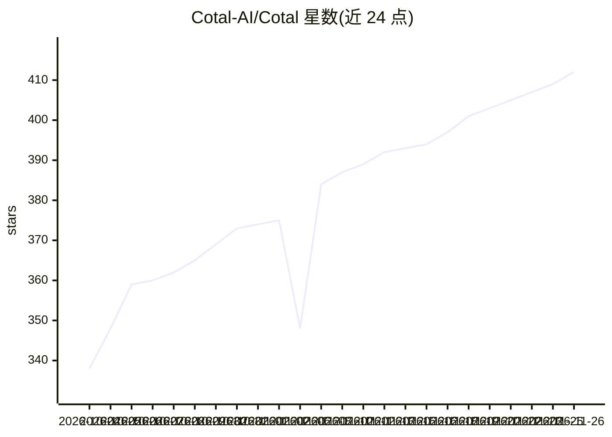

# Cotal-AI/Cotal

⭐ 412 · TypeScript · Apache-2.0 · 推送 2026-11-25 · [GitHub](https://github.com/Cotal-AI/Cotal) · [官网](https://cotal.ai) · 组织维护

**多智能体跨应用协作与编排的开源协调工具**

Cotal 让 AI 编码代理与服务在同一共享空间内跨应用、跨机器协作，定义身份、消息、在线状态与端点控制的标准，TypeScript 实现运行于 NATS + JetStream，附 CLI、应用连接器、进程管理器、持久化工作流（Cotal Lang）与观察工具。消息支持多播、单播、任意播三种投递模式，代理可从本地或远程主机加入，空间之间权限隔离。可通过 Cotal Cloud 托管或自建运行，默认发送使用遥测，可用命令关闭。

## 筛选速览

| 维度 | 判定 | 备注 |
|---|---|---|
| AI 角色 | `ai-ecosystem` | LLM/agent 周边工具 |
| 许可风险 | `permissive` | Apache-2.0 |
| 部署形态 | `library` | 以包/库形式分发 |
| 模型依赖 | — | README 未给出锁定关系 |
| 硬件要求 | — | 无带数字的原话,不猜 |
| 安装摩擦 | `low` | 无编译、无系统依赖或容器化 |
| 成熟度 | — | 结构信号不足 |

## 能力要点

- 三种消息投递模式：频道多播、点对点单播、按角色任意播
- Cotal Lang 工作流可从记录的进度恢复中断的运行
- 支持 Claude Code、OpenCode、Codex 等 6 种应用连接器
- 基于 NATS 账户的空间隔离与逐代理权限校验

## 适用场景

- 让多个编码代理在一个空间内交接发现、草稿与修复
- 搭建带人工审批节点的主管-执行者代理团队
- 在终端用 cotal console 观察代理团队与消息流
- 通过工作流脚本协调需要等待、分支或恢复的任务

## 场景标签

`多智能体` `工作流自动化` `Agent 框架` · 领域:Agent 开发

## 证据(README 行号)

> L35: Cotal lets AI agents and software services work together in a shared space, across
> L43: The open standard defines identity, messaging, presence and endpoint control. The
> L45: CLI, application connectors, a process manager, durable workflows and observation tools.

## 星数曲线

2026-10-24 338 → 2026-11-26 412（+74）

---
*卡片 v1 · prompt 1.4 · 生成 2026-11-25 · 置信度 high · 依据 README sha `ae7890639533` · [字段定义](../../DATASET.md)*
