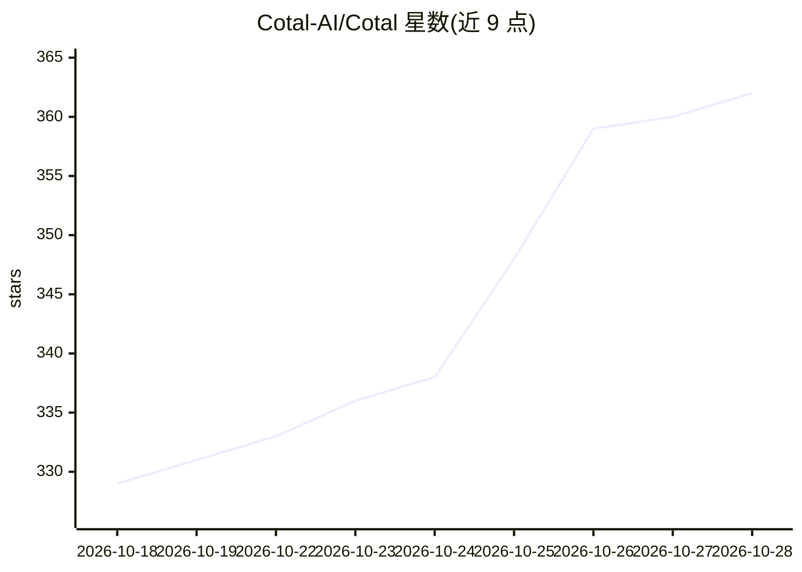

# Cotal-AI/Cotal

⭐ 362 · TypeScript · Apache-2.0 · 推送 2026-10-27 · [GitHub](https://github.com/Cotal-AI/Cotal) · [官网](https://cotal.ai) · 组织维护

**给多 AI agent 协作的开放 pub/sub 协调标准**

Cotal 是一个面向 AI agent 的开放 pub/sub 标准：让多个 agent 在同一共享空间中按用户自定义拓扑（对等、监督、层级、混合）协作，提供 multicast/unicast/anycast 三种寻址方式、presence 状态与 AgentCard 名册、持久投递与重放。基于 NATS+JetStream，复用 A2A 数据结构，参考实现为 TypeScript。提供 CLI（curl 安装脚本或 npm）、Cotal Lang 工作流、浏览器只读面板；支持 Claude Code、OpenCode、Codex 等 6 种 agent 接入。

## 筛选速览

| 维度 | 判定 | 备注 |
|---|---|---|
| AI 角色 | `ai-ecosystem` | LLM/agent 周边工具 |
| 许可风险 | `permissive` | Apache-2.0 |
| 部署形态 | `library` | 以包/库形式分发 |
| 模型依赖 | — | README 未给出锁定关系 |
| 硬件要求 | — | 无带数字的原话,不猜 |
| 安装摩擦 | `low` | 无编译、无系统依赖或容器化 |
| 成熟度 | — | 结构信号不足 |

## 能力要点

- multicast/unicast/anycast 三种寻址与 presence 状态共享
- 拓扑由配置定义：对等、管理者-工人、指挥链或任意混合
- Cotal Lang 工作流带步骤日志，可跨主机断点续跑
- 基于 NATS+JetStream，JWT 认证与按 agent 的 ACL

## 适用场景

- 让多个编码 agent 在同一 mesh 中协作完成任务
- 跨机器（笔记本/工作站/云容器）组建 agent 协作空间
- 用浏览器面板或终端 console 观察mesh 状态与消息流
- 编写可存活数小时并支持断点恢复的多 agent 工作流

## 场景标签

`多智能体` `工作流自动化` · 领域:Agent 开发

## 证据(README 行号)

> L28: **Cotal is a provider agnostic, cross-machine capable, and extensible open standard for AI agents to work together 
> L131: - **Cotal** brings pub/sub to agents: *many* of them coordinating live in one shared

## 星数曲线

2026-10-18 329 → 2026-10-28 362（+33）

---
*卡片 v1 · prompt 1.4 · 生成 2026-10-21 · 置信度 high · 依据 README sha `f03875847dc7` · [字段定义](../../DATASET.md)*
