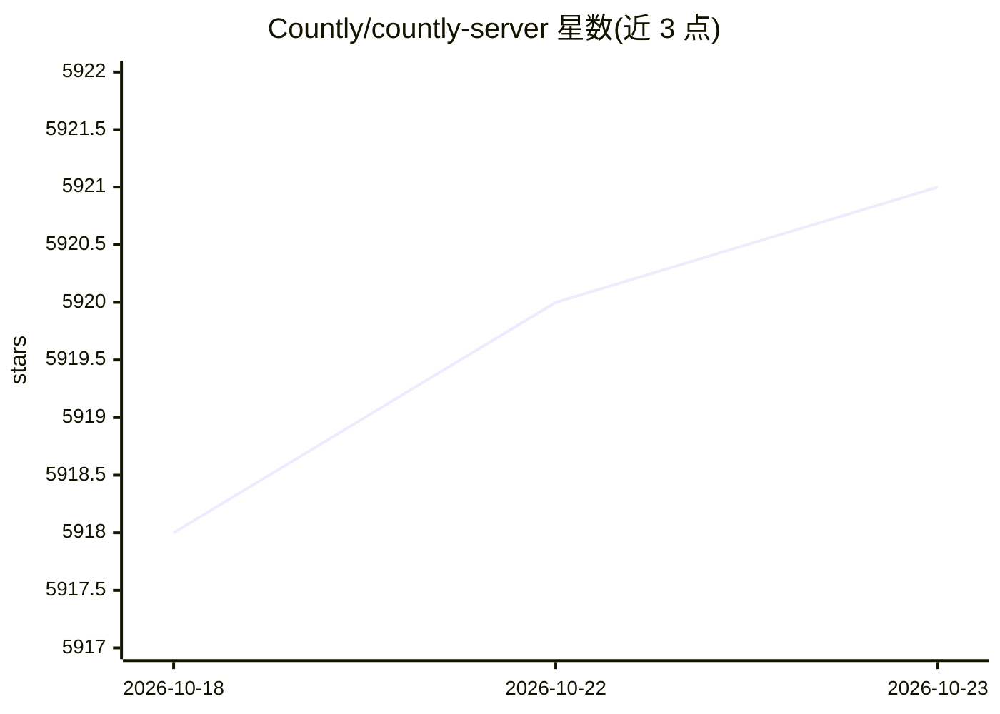

# Countly/countly-server

⭐ 5,921 · JavaScript · NOASSERTION · 推送 2026-10-22 · [GitHub](https://github.com/Countly/countly-server) · [官网](https://countly.com) · 组织维护

**可自部署的产品分析与用户互动平台（服务端）**

Countly 的服务端仓库，提供跨移动/Web/桌面应用的会话、浏览与事件采集和报表，崩溃上报（iOS/Android/React Native/Flutter/NodeJS/Unity/Java/JS），推送通知、远程配置、应用内评分、仪表盘与邮件报告，以及合规同意管理与读写 API。面向需要数据自持的组织，支持本地或私有云部署，可运行于 Ubuntu/CentOS/RHEL，提供一键安装脚本与 Docker 支持（Lite 版）。采用基于插件的架构与 MongoDB/NodeJS 技术栈；Lite 版为 AGPL-3.0（修改第 7 条）非商业许可，另有商业版本。

## 筛选速览

| 维度 | 判定 | 备注 |
|---|---|---|
| AI 角色 | `ai-enhanced` | 去掉 AI 部分产品仍成立 |
| 许可风险 | `none` | NOASSERTION |
| 部署形态 | `None` |  |
| 模型依赖 | — | README 未给出锁定关系 |
| 硬件要求 | — | 无带数字的原话,不猜 |
| 安装摩擦 | `low` | 无编译、无系统依赖或容器化 |
| 成熟度 | — | 结构信号不足 |

## 能力要点

- 会话/浏览/事件采集与崩溃上报，覆盖多平台 SDK
- 推送通知、远程配置、应用内评分与自定义仪表盘
- 插件化架构与读写 API，支持外部 webhook 转发
- 支持一键安装脚本与 Docker 部署（Lite 版）

## 适用场景

- 自托管部署产品分析平台，掌控数据与合规
- 追踪移动/Web/桌面应用的用户行为与崩溃
- 通过推送、远程配置与评分组件做用户互动

## 场景标签

`数据分析` · 领域:效率与自动化

## 证据(README 行号)

> L14: Countly is a **privacy-first, AI-ready analytics and customer engagement platform** built for organizations that re
> L25: **Built for privacy. Designed for flexibility. Ready for AI-driven innovation.**

## 星数曲线

2026-10-18 5,918 → 2026-10-23 5,921（+3）

---
*卡片 v1 · prompt 1.4 · 生成 2026-10-20 · 置信度 mid · 依据 README sha `3f9c3cbd13d8` · [字段定义](../../DATASET.md)*
