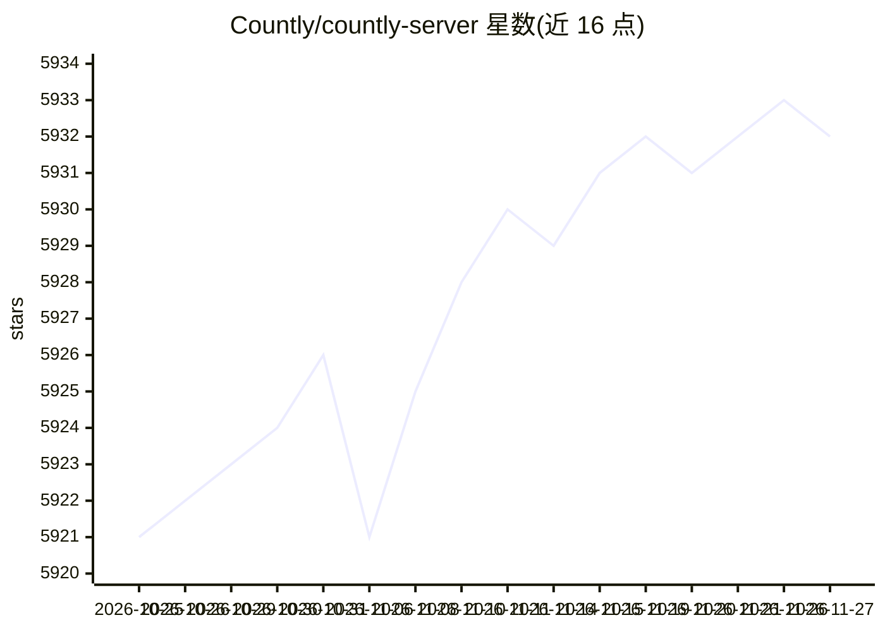

# Countly/countly-server

⭐ 5,932 · JavaScript · NOASSERTION · 推送 2026-11-26 · [GitHub](https://github.com/Countly/countly-server) · [官网](https://countly.com) · 组织维护

**面向企业的私有化部署产品分析与用户参与平台**

Countly 服务端为组织提供自有部署的产品分析与客户参与平台，支持本地或私有云安装，覆盖会话/视图/事件采集、iOS/Android 等多端崩溃报告、推送通知、远程配置、仪表盘、合规管理（Consent 收集与数据主体请求）以及读写 API。采用插件化架构可扩展，前端基于 NodeJS 与 MongoDB 构建。提供 Lite（开源非商业许可、自托管）、Enterprise 与 Flex 三个版本，SDK 跨版本一致。

## 筛选速览

| 维度 | 判定 | 备注 |
|---|---|---|
| AI 角色 | `ai-enhanced` | 去掉 AI 部分产品仍成立 |
| 许可风险 | `none` | NOASSERTION |
| 部署形态 | `self-host` | docker 或自建部署 |
| 模型依赖 | — | README 未给出锁定关系 |
| 硬件要求 | — | 无带数字的原话,不猜 |
| 安装摩擦 | `low` | 无编译、无系统依赖或容器化 |
| 成熟度 | — | 结构信号不足 |

## 能力要点

- 本地或私有云部署，宣称完整数据所有权
- 多平台崩溃报告（iOS/Android/React Native/Flutter 等）
- 读写 API 与插件架构支持自定义扩展
- docker-compose 一键启动 MongoDB/API/前端/nginx

## 适用场景

- 自托管分析移动与 Web 应用的用户行为
- 收集 App 崩溃报告并推送通知
- 满足 GDPR/合规要求的数据主体请求管理
- 通过 Write API 接入任意来源数据

## 场景标签

 · 领域:企业服务/数据分析

## 证据(README 行号)

> L14: Countly is a **privacy-first, AI-ready analytics and customer engagement platform** built for organizations that re
> L53: This repository includes server-side part of Countly, with the following features:

## 星数曲线

2026-10-25 5,921 → 2026-11-27 5,932（+11）

---
*卡片 v1 · prompt 1.4 · 生成 2026-11-22 · 置信度 high · 依据 README sha `f09987921b93` · [字段定义](../../DATASET.md)*
