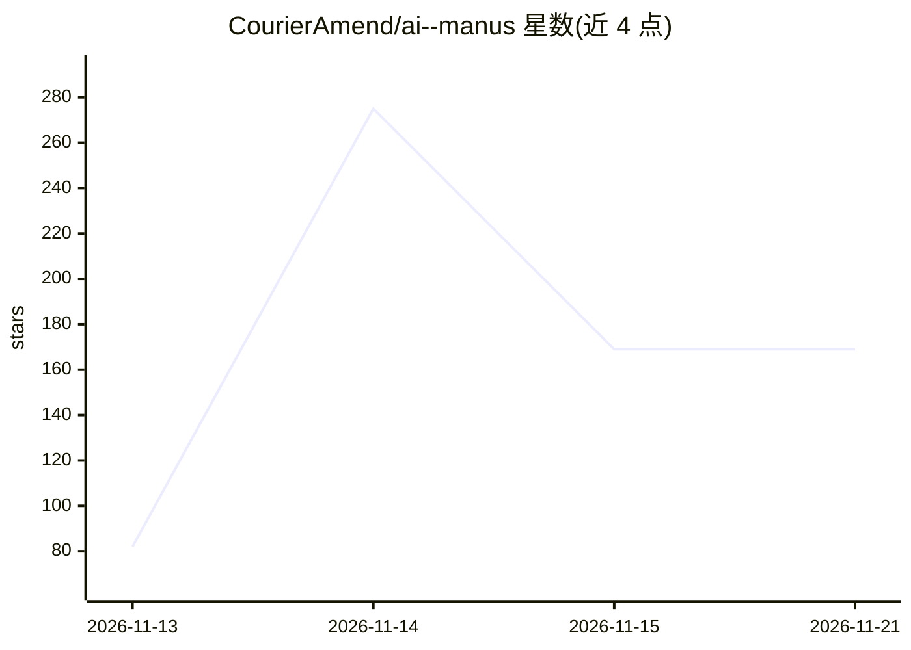

# CourierAmend/ai--manus

⭐ 169 · Apache-2.0 · 推送 2026-11-15 · [GitHub](https://github.com/CourierAmend/ai--manus) · 个人维护

**自主执行代码与浏览器的通用 AI Agent 系统**

面向个人用户（学生、远程工作者）的自主 AI Agent：可自行编写并执行脚本、控制浏览器（导航网页、填写表单、采集信息）、执行多步骤任务，无需用户具备开发背景。定位为家庭、学习与轻量办公场景的后台个人助手，非企业平台。README 给出硬件兼容表（最低双核 CPU、4 GB 内存）与使用步骤说明，但未提供具体安装命令或技术实现细节。

## 筛选速览

| 维度 | 判定 | 备注 |
|---|---|---|
| AI 角色 | `ai-native` | 本体是模型或模型工具 |
| 许可风险 | `permissive` | Apache-2.0 |
| 部署形态 | `None` |  |
| 模型依赖 | — | README 未给出锁定关系 |
| 硬件要求 | — | 无带数字的原话,不猜 |
| 安装摩擦 | `low` | 无编译、无系统依赖或容器化 |
| 成熟度 | — | 结构信号不足 |

## 能力要点

- 自主执行代码完成多步骤任务
- 浏览器控制：导航、填表、信息采集
- 面向非开发者的个人助手定位，跨会话保持一致行为
- 沙箱环境中运行各类工具与操作（仓库描述）

## 适用场景

- 让 AI 代为完成查网页、填表单等重复性浏览器操作
- 运行小脚本、整理研究笔记与快速计算
- 日常多任务中委派琐碎工作给后台 Agent

## 场景标签

`AI 助手` `浏览器自动化` `编码 Agent` · 领域:效率与自动化

## 证据(README 行号)

> L10: - **Autonomous Code Execution:** Manus AI agent runs code on its own to complete tasks, so you can focus on decisio
> L18: Manus is an autonomous AI agent designed to run code and control a browser on your behalf. Instead of acting like a

## 星数曲线

2026-11-13 82 → 2026-11-21 169（+87）

---
*卡片 v1 · prompt 1.4 · 生成 2026-11-17 · 置信度 mid · 依据 README sha `0f78ee3a5dd2` · [字段定义](../../DATASET.md)*
