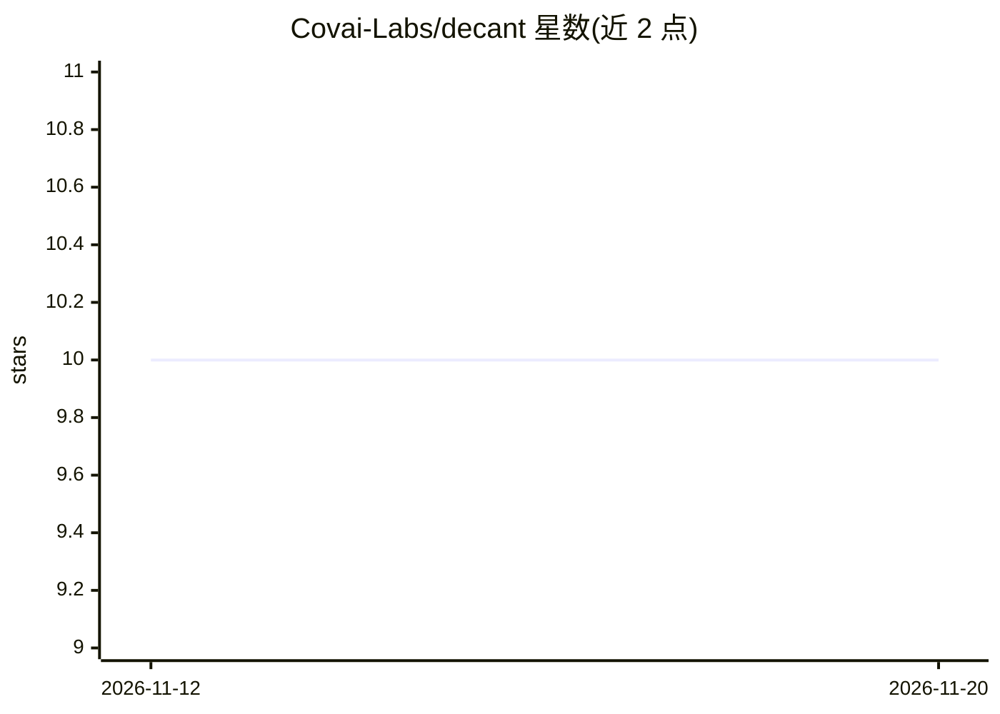

# Covai-Labs/decant

⭐ 10 · JavaScript · AGPL-3.0 · 推送 2026-11-19 · [GitHub](https://github.com/Covai-Labs/decant) · [官网](http://decant.js.org/) · 组织维护

**AI 对话与网页文章的共享提取解析层，供开发者复用**

一个 npm 库，为 ChatGPT、Claude、Gemini、Perplexity、DeepSeek 等 19 个 AI 聊天平台提供 DOM/API 级解析器，输出结构化消息、模型信息、元数据与 Markdown；另含网页文章提取（Readability/Defuddle/Article-Extractor 并行仲裁）、AI 页面检测工具、LaTeX 与 GFM 表格规范化。设计动机是平台 DOM 变更导致各导出工具解析器反复失效，将解析逻辑集中维护。全部处理在本地进行，不以模型推理为功能。

## 筛选速览

| 维度 | 判定 | 备注 |
|---|---|---|
| AI 角色 | `ai-ecosystem` | LLM/agent 周边工具 |
| 许可风险 | `dual` | AGPL-3.0 |
| 部署形态 | `library` | 以包/库形式分发 |
| 模型依赖 | locked-api |  |
| 硬件要求 | — | 无带数字的原话,不猜 |
| 安装摩擦 | `low` | 无编译、无系统依赖或容器化 |
| 成熟度 | — | 结构信号不足 |

## 能力要点

- 19 个 AI 聊天平台解析器，统一 ChatParser 接口与规范化输出
- 网页文章提取：三个提取器并行并按内容质量评分仲裁
- AI 聊天页面与普通网页的检测工具
- 支持子路径按需引入单个解析器以便 tree-shaking

## 适用场景

- 开发浏览器扩展导出 ChatGPT/Claude 等对话为 Markdown
- 构建本地优先的网页剪藏与归档工具
- 为研究或知识管理工具批量提取 AI 对话数据

## 场景标签

`文档解析` `网页抓取` · 领域:效率与自动化

## 证据(README 行号)

> L13: `decant-core` provides reusable parsers, platform detection, and web article extraction so developers don't have to
> L19: `decant-core` was created to solve both at the foundation. Originally built to power local-first extensions like AI
> L28: Use it as the parsing layer underneath your own:

## 星数曲线

2026-11-12 10 → 2026-11-20 10（+0）

---
*卡片 v1 · prompt 1.4 · 生成 2026-11-20 · 置信度 mid · 依据 README sha `c0376c4ebbfb` · [字段定义](../../DATASET.md)*
