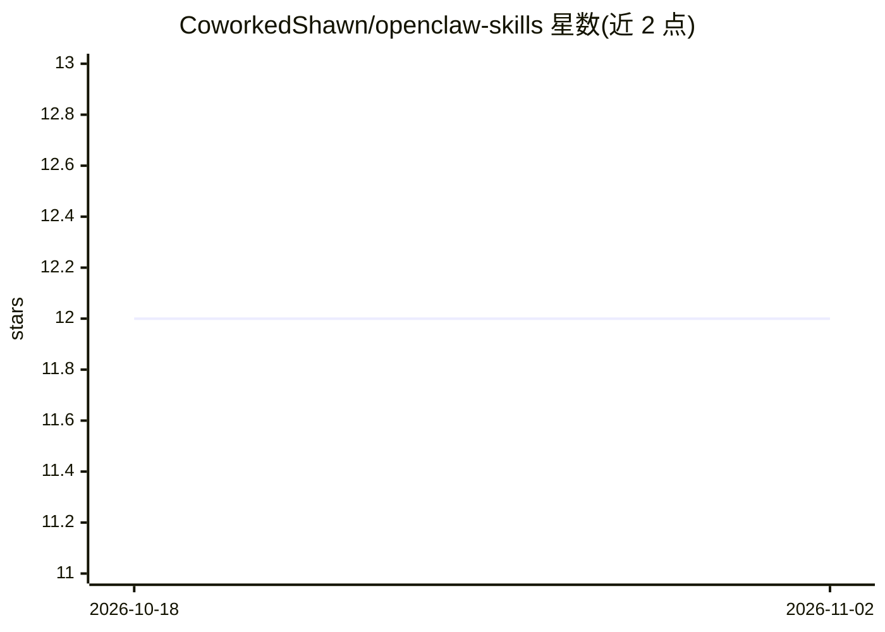

# CoworkedShawn/openclaw-skills

⭐ 12 · JavaScript · 推送 2026-02-20 · [GitHub](https://github.com/CoworkedShawn/openclaw-skills) · [官网](https://shawnharris.com/building-a-cognitive-architecture-for-your-openclaw-agent/) · 个人维护

**给 OpenClaw AI agent 的自定义技能集：记忆/安全/路由/平台集成**

为 OpenClaw agent 框架提供的技能集合，含 7 个技能：基于认知科学的记忆引擎（输入/输出门控、分层记忆、runbook）、四层提示注入防御、基于意图的模型路由（Haiku/Opus/Sonnet 分级），以及 Microsoft Graph 邮件、WordPress、Meta 社交平台、HeyGen 视频等集成。安装方式为 git clone 后复制或符号链接到 ~/.openclaw/workspace/skills/，由 OpenClaw 自动发现。各技能以 SKILL.md 形式提供设置说明与凭证存储指引（macOS Keychain）。README 标注为作者自用场景构建，附博客实现记录。

## 筛选速览

| 维度 | 判定 | 备注 |
|---|---|---|
| AI 角色 | `ai-ecosystem` | LLM/agent 周边工具 |
| 许可风险 | `permissive` | — |
| 部署形态 | `None` |  |
| 模型依赖 | — | README 未给出锁定关系 |
| 硬件要求 | — | 无带数字的原话,不猜 |
| 安装摩擦 | `low` | 无编译、无系统依赖或容器化 |
| 成熟度 | — | 结构信号不足 |

## 能力要点

- 记忆引擎基于 David Badre《On Task》，含输入/输出门控与分层记忆（MEMORY.md/active-context/日志）
- 四层提示注入防御（宣称 99% 威胁拦截、<3% 误报）
- 意图路由按任务复杂度选择模型（简单→Haiku，复杂→Opus）
- 平台集成覆盖 M365 邮件、WordPress、Meta 社交、HeyGen 视频

## 适用场景

- 给 OpenClaw agent 添加跨会话记忆与上下文管理
- 为 agent 增加提示注入防御层
- 让 agent 按意图自动路由模型以降低 API 成本
- 通过 agent 收发邮件、发布内容与生成视频

## 场景标签

`Agent 记忆` · 领域:Agent 开发

## 证据(README 行号)

> L3: Custom skills for OpenClaw AI agents — extending capabilities with cognitive memory systems, security, platform inte
> L25: |memory-engine|🧠 Cognitive control memory system based on "On Task" by David Badre. Input/output gating, hierarchic
> L69: OpenClaw automatically discovers skills from the `skills/` directory.

## 星数曲线

2026-10-18 12 → 2026-11-02 12（+0）

---
*卡片 v1 · prompt 1.4 · 生成 2026-11-01 · 置信度 high · 依据 README sha `960911c1aeb6` · [字段定义](../../DATASET.md)*
