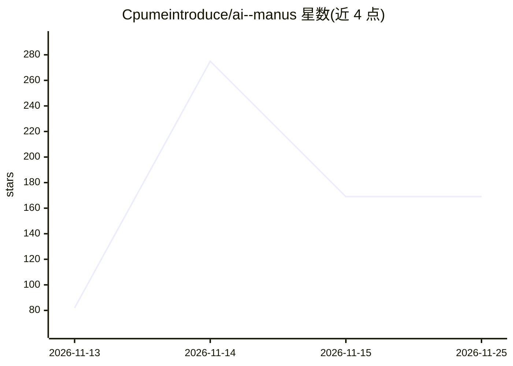

# Cpumeintroduce/ai--manus

⭐ 169 · Apache-2.0 · 推送 2026-11-15 · [GitHub](https://github.com/Cpumeintroduce/ai--manus) · 个人维护

**面向日常任务的自主 AI Agent：自动执行代码与浏览器操作**

Manus 是一个自主 AI Agent，宣称可在最少监督下编写并执行脚本、控制浏览器完成多步任务（打开网页、填写表单、收集信息），定位为家庭、学习与轻量办公场景的个人助手，而非企业平台或重型工作室。README 以功能描述和使用建议为主，提供了运行环境兼容性表（最低 4 GB 内存、双核 CPU、现代 64 位系统），但未给出任何具体的安装命令、下载渠道细节、模型接入方式或代码仓库结构说明。

## 筛选速览

| 维度 | 判定 | 备注 |
|---|---|---|
| AI 角色 | `ai-native` | 本体是模型或模型工具 |
| 许可风险 | `permissive` | Apache-2.0 |
| 部署形态 | `None` |  |
| 模型依赖 | — | README 未给出锁定关系 |
| 硬件要求 | — | 无带数字的原话,不猜 |
| 安装摩擦 | `low` | 无编译、无系统依赖或容器化 |
| 成熟度 | — | 结构信号不足 |

## 能力要点

- 自主编写并执行代码完成多步任务
- 浏览器控制：导航网页、填写表单、采集信息
- 代码与浏览器操作可在同一工作流中衔接
- 声明支持会话间记住并复用工作流模式

## 适用场景

- 让 agent 代为查网页、填表单、收集资料
- 自动执行重复性小脚本与文件整理
- 学习与轻量办公中委托多步小任务

## 场景标签

`AI 助手` `浏览器自动化` `编码 Agent` · 领域:效率与自动化

## 证据(README 行号)

> L18: Manus is an autonomous AI agent designed to run code and control a browser on your behalf. Instead of acting like a
> L22: Manus is not a heavy studio suite or a complex enterprise platform. It is a focused helper built for home, study, a

## 星数曲线

2026-11-13 82 → 2026-11-25 169（+87）

---
*卡片 v1 · prompt 1.4 · 生成 2026-11-17 · 置信度 low · 依据 README sha `0f78ee3a5dd2` · [字段定义](../../DATASET.md)*
