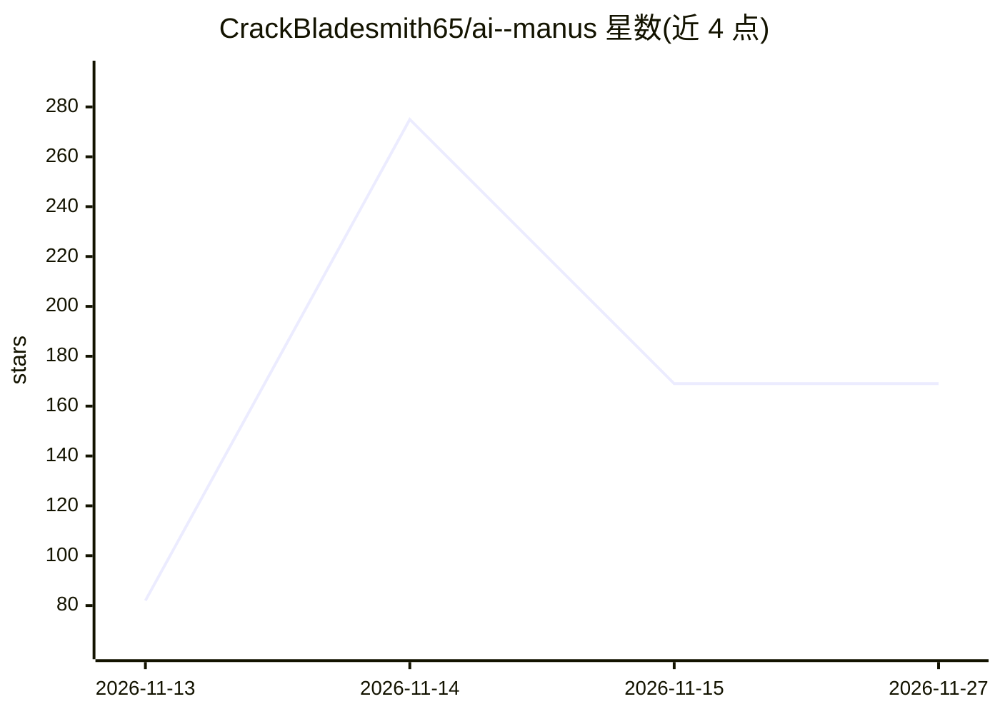

# CrackBladesmith65/ai--manus

⭐ 169 · Apache-2.0 · 推送 2026-11-15 · [GitHub](https://github.com/CrackBladesmith65/ai--manus) · 个人维护

**自主执行代码与浏览器操作的通用 AI Agent 助手**

README 描述 Manus 为可自主运行代码并控制浏览器的 AI agent：能编写和执行脚本、打开网页、与页面元素交互并完成多步任务，面向学习、家庭与轻量办公场景的非开发者用户。内容以功能介绍、使用建议和硬件兼容表为主，给出最低 4GB 内存等配置要求，但未提供任何安装命令、依赖清单、源码结构或 API 接入说明，技术机制描述停留在功能层面。

## 筛选速览

| 维度 | 判定 | 备注 |
|---|---|---|
| AI 角色 | `ai-native` | 本体是模型或模型工具 |
| 许可风险 | `permissive` | Apache-2.0 |
| 部署形态 | `None` |  |
| 模型依赖 | — | README 未给出锁定关系 |
| 硬件要求 | — | 无带数字的原话,不猜 |
| 安装摩擦 | `low` | 无编译、无系统依赖或容器化 |
| 成熟度 | — | 结构信号不足 |

## 能力要点

- 自主编写并执行代码完成多步任务
- 浏览器控制：导航网页、填表、抓取信息
- 面向学习、家庭项目与轻量办公的小规模场景

## 适用场景

- 让学生整理研究笔记并运行小脚本
- 让 agent 代为浏览网页、填表与汇总信息
- 远程工作者从多个页面收集数据生成摘要

## 场景标签

`编码 Agent` `浏览器自动化` `AI 助手` · 领域:效率与自动化

## 证据(README 行号)

> L18: Manus is an autonomous AI agent designed to run code and control a browser on your behalf. Instead of acting like a
> L10: - **Autonomous Code Execution:** Manus AI agent runs code on its own to complete tasks, so you can focus on decisio

## 星数曲线

2026-11-13 82 → 2026-11-27 169（+87）

---
*卡片 v1 · prompt 1.4 · 生成 2026-11-17 · 置信度 low · 依据 README sha `0f78ee3a5dd2` · [字段定义](../../DATASET.md)*
