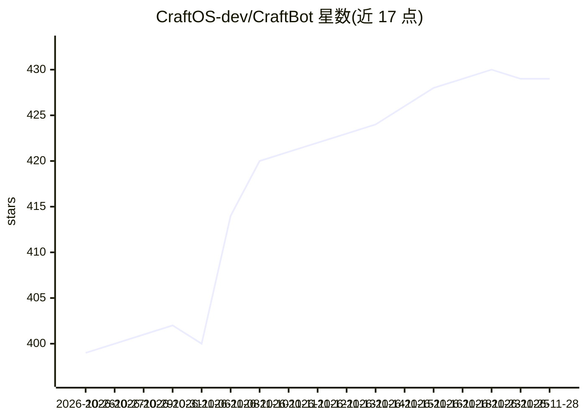

# CraftOS-dev/CraftBot

⭐ 429 · Python · MIT · 推送 2026-11-25 · [GitHub](https://github.com/CraftOS-dev/CraftBot) · [官网](https://craftbot.live/) · 组织维护 · 中文 README

**自建并运营 SaaS 工具的通用 AI agent 平台**

面向个人与小团队的通用 agent harness：除对话与工具调用外，可用自然语言生成、导入并持续迭代自己的 Agent App（数据模型、后端 API、React UI），agent 可读取应用 DOM 与 REST 数据并代为操作。内置 40+ Agent Profiles、120 个 Playbook、150+ MCP 与 170+ Skills，混合记忆系统（RAG + 知识图谱 + Agent File System），支持主动规划任务。自托管、BYOK，提供安装包与源码两种安装方式，浏览器 UI 与终端 TUI 双形态。

## 筛选速览

| 维度 | 判定 | 备注 |
|---|---|---|
| AI 角色 | `ai-ecosystem` | LLM/agent 周边工具 |
| 许可风险 | `permissive` | MIT |
| 部署形态 | `desktop` | 安装包/桌面程序 |
| 模型依赖 | local-ok | 支持本地模型 |
| 硬件要求 | — | 无带数字的原话,不猜 |
| 安装摩擦 | `low` | 无编译、无系统依赖或容器化 |
| 成熟度 | — | 结构信号不足 |

## 能力要点

- 构建/导入/迭代 Agent App，agent 可感知 UI 状态并代为读写操作
- 40+ Agent Profiles、120 Playbook、150+ MCP 与 170+ Skills 生态
- 混合记忆系统：RAG + 知识图谱 + Agent File System，每日自动整合
- 自托管 BYOK，支持 OpenAI/Gemini/Claude/OpenRouter 及本地 Ollama

## 适用场景

- 让 agent 替我搭建并运营看板、CRM、习惯追踪等内部工具
- 通过 Playbook 把日常任务交给 AI 自动执行
- 配置 Google Workspace、Slack、Notion 等账号做跨应用自动化
- 用本地模型零 token 成本自托管运行 agent

## 场景标签

`知识图谱` `RAG` `浏览器自动化` · 领域:效率与自动化

## 证据(README 行号)

> L3: Most agent harnesses stop at chat and tool calls. CraftBot goes further than that. It builds, evolves, and operates 
> L31: Aside from being an AI agent that can create and operate its own SaaS tools, CraftBot includes all the core feature
> L37: - **Self-hosted and BYOK.** Flexible LLM provider system supporting OpenAI, Google Gemini, Anthropic Claude, OpenRo

## 星数曲线

2026-10-26 399 → 2026-11-28 429（+30）

---
*卡片 v1 · prompt 1.4 · 生成 2026-11-25 · 置信度 mid · 依据 README sha `9780cfaf8b42` · [字段定义](../../DATASET.md)*
