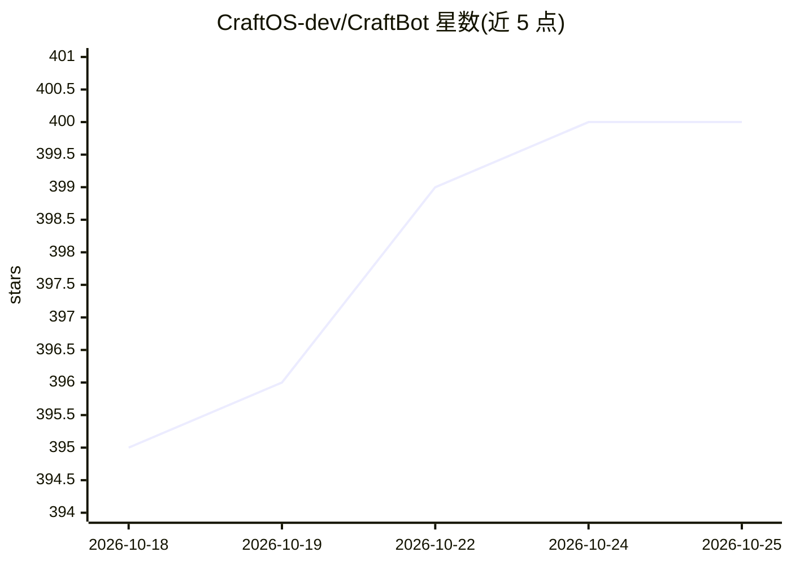

# CraftOS-dev/CraftBot

⭐ 399 · Python · MIT · 推送 2026-10-23 · [GitHub](https://github.com/CraftOS-dev/CraftBot) · [官网](https://craftbot.live/) · 组织维护 · 中文 README

**通用 AI agent 平台：可自建并运行 SaaS 工具的智能体框架**

CraftBot 是一个自托管的通用 AI agent 框架，定位为像远程员工一样执行任务的助手：内置 40+ agent 角色模板、120 个 playbook（19 类）、可自建/导入/持续演化的 Agent App（自动生成数据模型、后端 API 与 React UI）、RAG+知识图谱+文件系统的混合记忆、主动规划任务，以及 150+ MCP 与 170+ Skills。支持 BYOK 多 LLM 提供商（OpenAI/Gemini/Claude/OpenRouter 等）或用 Ollama 自托管模型。通过浏览器 UI 或 CLI 使用，提供 Docker 配置。限制：处于活跃开发中（每周更新），浏览器模式需 Node.js 18+。

## 筛选速览

| 维度 | 判定 | 备注 |
|---|---|---|
| AI 角色 | `ai-native` | 本体是模型或模型工具 |
| 许可风险 | `permissive` | MIT |
| 部署形态 | `self-host` | docker 或自建部署 |
| 模型依赖 | local-ok | 支持本地模型 |
| 硬件要求 | — | 无带数字的原话,不猜 |
| 安装摩擦 | `low` | 无编译、无系统依赖或容器化 |
| 成熟度 | `idea` | |

## 能力要点

- 40+ agent 角色模板与 120 个 playbook（19 类）
- Agent App：自然语言构建/导入 Go/Node/Python/Rust 项目并持续演化
- RAG+知识图谱+Agent 文件系统的混合记忆，夜间自动整理
- 150+ MCP 与 170+ Skills，BYOK 支持 Ollama 自托管零 token 运行

## 适用场景

- 让 agent 像远程员工一样执行日常任务并记住偏好
- 用自然语言搭建看板、CRM 等自定义工具并由 agent 操作
- 通过 Slack/Notion/Google Workspace 等集成连接现有应用

## 场景标签

`Agent 框架` `GUI 自动化` `浏览器自动化` · 领域:Agent 开发

## 证据(README 行号)

> L3: Most agent harnesses stop at chat and tool calls. CraftBot goes further than that. It builds, evolves, and operates 
> L31: Aside from being an AI agent that can create and operate its own SaaS tools, CraftBot includes all the core feature

## 星数曲线

2026-10-18 395 → 2026-10-25 400（+5）

---
*卡片 v1 · prompt 1.4 · 生成 2026-10-21 · 置信度 mid · 依据 README sha `a69191010fe7` · [字段定义](../../DATASET.md)*
