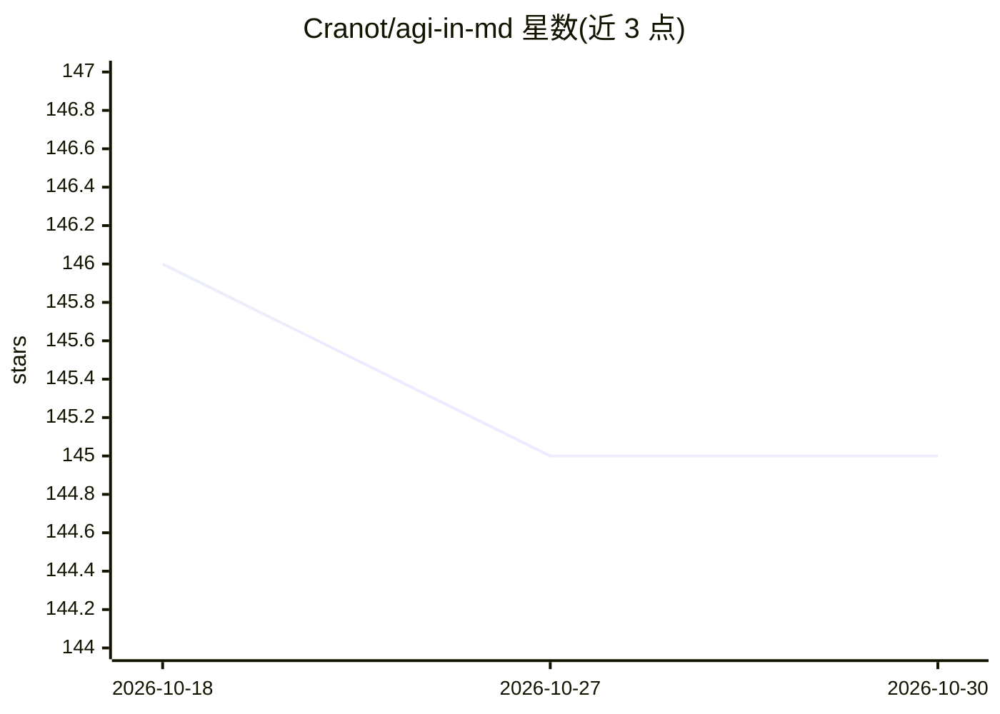

# Cranot/agi-in-md

⭐ 145 · Python · MIT · 推送 2026-03-18 · [GitHub](https://github.com/Cranot/agi-in-md) · 个人维护

**用 markdown 提示词“棱镜”驱动 Claude 做结构化分析的 CLI 工具**

以 58 个 markdown 格式系统提示词（prism）为核心的分析工具：每个 prism 规定有序认知操作（提出可证伪声明→三重攻击→构建改进→观察破坏→推导守恒律），通过 prism.py 交互式 REPL 或 CLI 调用 Claude Code CLI 对代码或任意文本执行分析，提供 27 种扫描模式（单次/Full/Oracle/Verified 等管道），L12-G 与 Oracle 模式含自我审计与声明标签。面向使用 Claude 订阅的开发者；依赖 Python 3.9+ 与 Claude Code，无需 API key。README 声明评价指标为 AI 评分，且具体 bug 断言应视为假设。

## 筛选速览

| 维度 | 判定 | 备注 |
|---|---|---|
| AI 角色 | `ai-native` | 本体是模型或模型工具 |
| 许可风险 | `permissive` | MIT |
| 部署形态 | `library` | 以包/库形式分发 |
| 模型依赖 | locked-api |  |
| 硬件要求 | — | 无带数字的原话,不猜 |
| 安装摩擦 | `low` | 无编译、无系统依赖或容器化 |
| 成熟度 | — | 结构信号不足 |

## 能力要点

- 58 个 markdown prism + 27 种扫描模式的提示词分析体系
- prism.py 包装 Claude Code CLI，无需 API key，使用 Claude 订阅
- Oracle 模式单次调用完成 5 阶段分析并为每条声明打标签（STRUCTURAL/DERIVED/KNOWLEDGE/ASSUMED）
- Oracle/Verified 等模式针对虚构输出（confabulation）做自我审计与修正

## 适用场景

- 对代码文件做结构化分析，推导设计中不可回避的权衡（守恒律）
- 用低成本模型（Haiku）配合 prism 完成深度分析以控制成本
- 对分析结果做声明分级与可验证性检查

## 场景标签

`提示工程` · 领域:Agent 开发

## 证据(README 行号)

> L7: A **prism** is a markdown system prompt that acts as a cognitive program — it tells the model to do specific things 
> L57: python prism.py --scan auth.py oracle     # maximum trust, 5-phase
> L77: No API key needed — `prism.py` wraps the Claude Code CLI, which uses your Claude subscription. Use `python3` instea

## 星数曲线

2026-10-18 146 → 2026-10-30 145（-1）

---
*卡片 v1 · prompt 1.4 · 生成 2026-10-23 · 置信度 mid · 依据 README sha `6875999c14f3` · [字段定义](../../DATASET.md)*
