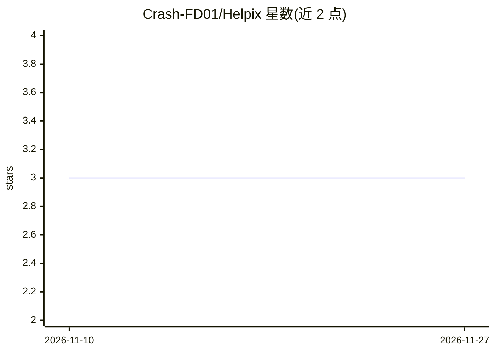

# Crash-FD01/Helpix

⭐ 3 · Python · GPL-3.0 · 推送 2026-11-19 · [GitHub](https://github.com/Crash-FD01/Helpix) · [官网](https://crash-fd01.github.io/Helpix) · 个人维护

**借你已有的 AI 账号诊断并修复 Linux/Windows 电脑问题**

一款 Linux 与 Windows 桌面应用（PySide6/Qt6），围绕用户已有的 ChatGPT、Claude、Gemini、Copilot、DeepSeek 账号组织电脑排障流程：在聊天中截取屏幕问题区域、一键执行 AI 建议的命令并把结果回贴对话（危险命令先告警）、采集磁盘/内存/网络/错误等诊断信息供用户确认后发送、全局快捷键 Ctrl+Alt+H 快速提问、携带已完成步骤摘要在不同 AI 之间切换。应用仅在用户按下按钮时操作，不自行执行命令，无账号无数据收集。Linux 经脚本安装并随系统更新，Windows 提供未签名的 Setup 安装包。

## 筛选速览

| 维度 | 判定 | 备注 |
|---|---|---|
| AI 角色 | `ai-native` | 本体是模型或模型工具 |
| 许可风险 | `viral` | GPL-3.0 |
| 部署形态 | `desktop` | 安装包/桌面程序 |
| 模型依赖 | — | README 未给出锁定关系 |
| 硬件要求 | — | 无带数字的原话,不猜 |
| 安装摩擦 | `low` | 无编译、无系统依赖或容器化 |
| 成熟度 | — | 结构信号不足 |

## 能力要点

- 截图直接进入 AI 对话，配合账号登录使用
- AI 建议命令的一键执行与风险提示，结果回贴聊天
- 采集磁盘、内存、网络与错误信息生成诊断
- 携带问题摘要在不同 AI 服务间切换不重头开始

## 适用场景

- 遇到电脑问题想用已有的 AI 账号排查
- 让 AI 看到屏幕上的报错再给方案
- 不放心直接粘贴命令，希望先提示风险再执行

## 场景标签

`AI 助手` · 领域:对话与助手

## 证据(README 行号)

> L8: Apri Helpix, accedi a ChatGPT, Claude, Gemini, Copilot o DeepSeek (va bene anche l'account gratuito) e spiega
> L9: cosa non va. Helpix ti aiuta a mostrare il problema all'IA e a mettere in pratica la soluzione.
> L16: - 📸 **Screenshot nella chat** — selezioni la parte dello schermo con il problema e l'immagine finisce

## 星数曲线

2026-11-10 3 → 2026-11-27 3（+0）

---
*卡片 v1 · prompt 1.4 · 生成 2026-11-22 · 置信度 high · 依据 README sha `9bc89aa9e7f3` · [字段定义](../../DATASET.md)*
