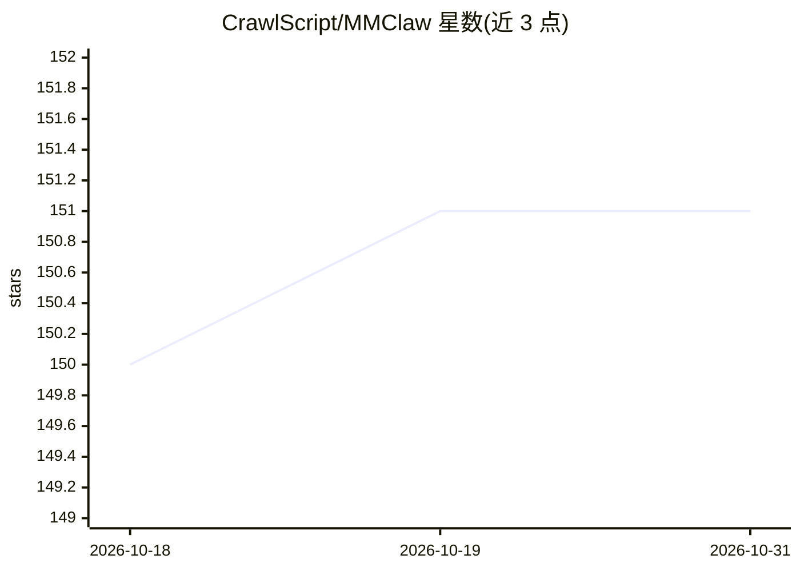

# CrawlScript/MMClaw

⭐ 151 · Python · GPL-3.0 · 推送 2026-10-25 · [GitHub](https://github.com/CrawlScript/MMClaw) · 组织维护 · 中文 README

**纯 Python 极简多模态自主 agent 内核，多渠道接入**

100% 纯 Python（无 C 扩展、无 Node.js、无 Docker）的自主 agent 内核，处理 agent 循环与工具调用，支持通过 Telegram、WhatsApp、微信、飞书、QQ 机器人等渠道对话式驱动 agent，执行文件处理、Web 搜索、浏览器自动化、定时任务与多工作区隔离运行。LLM 接入覆盖 OpenAI、Codex OAuth、Gemini、DeepSeek、Kimi、MiniMax 及 OpenAI 兼容端点（Ollama、LocalAI）。架构定位为可读内核兼教程，微信连接器零额外依赖。限制：WhatsApp 模式需 Node.js 桥接；飞书需 lark-oapi 依赖。

## 筛选速览

| 维度 | 判定 | 备注 |
|---|---|---|
| AI 角色 | `ai-ecosystem` | LLM/agent 周边工具 |
| 许可风险 | `viral` | GPL-3.0 |
| 部署形态 | `library` | 以包/库形式分发 |
| 模型依赖 | local-ok | 支持本地模型 |
| 硬件要求 | — | 无带数字的原话,不猜 |
| 安装摩擦 | `low` | 无编译、无系统依赖或容器化 |
| 成熟度 | — | 结构信号不足 |

## 能力要点

- 纯 Python 实现，支持 Windows/macOS/Linux/树莓派
- Telegram/微信/飞书/QQ/WhatsApp 多渠道连接器
- SkillKG 技能知识图谱与安全检查
- 多工作区隔离运行与跨会话持久记忆

## 适用场景

- 通过聊天软件远程控制本机 agent 执行任务
- 在树莓派等轻量环境运行个人 AI 助手
- 按需扩展自定义技能并阅读源码学习 agent 构建

## 场景标签

`Agent 框架` `AI 助手` `浏览器自动化` · 领域:Agent 开发

## 证据(README 行号)

> L19: MMClaw is a minimalist, 100% Pure Python autonomous agent kernel. While frameworks like OpenClaw offer great power,
> L21: MMClaw strips away the complexity, offering a crystal-clear, readable architecture that serves as both a production
> L74: The trend in AI agents is moving towards massive complexity. MMClaw moves towards clarity. Most developers don't ne

## 星数曲线

2026-10-18 150 → 2026-10-31 151（+1）

---
*卡片 v1 · prompt 1.4 · 生成 2026-10-22 · 置信度 high · 依据 README sha `9a792adfe3e6` · [字段定义](../../DATASET.md)*
