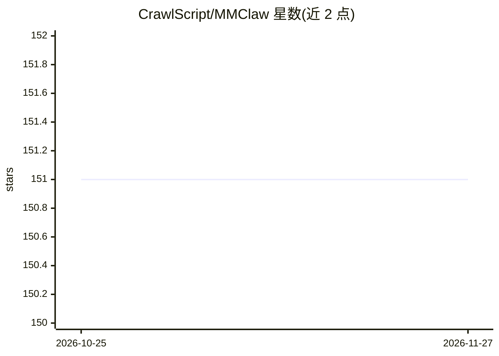

# CrawlScript/MMClaw

⭐ 151 · Python · GPL-3.0 · 推送 2026-10-25 · [GitHub](https://github.com/CrawlScript/MMClaw) · 个人维护 · 中文 README

**纯 Python 轻量多模态 Agent 内核，可接入多渠道聊天**

以 100% 纯 Python 实现的自主 Agent 内核，无 C 扩展、无 Node.js、无 Docker 依赖，Python 3.8+ 即可 pip 安装运行。提供 Agent 循环与工具调用、持久记忆、技能系统（含 SkillKG 技能知识图谱与安全检查）、定时任务、网页搜索与可选 Playwright 浏览器自动化。支持 Telegram/微信/飞书/QQ/WhatsApp 等连接器与多工作区隔离实例，同时定位为可读的 Agent 构建教程。

## 筛选速览

| 维度 | 判定 | 备注 |
|---|---|---|
| AI 角色 | `ai-ecosystem` | LLM/agent 周边工具 |
| 许可风险 | `viral` | GPL-3.0 |
| 部署形态 | `library` | 以包/库形式分发 |
| 模型依赖 | local-ok | 支持本地模型 |
| 硬件要求 | — | 无带数字的原话,不猜 |
| 安装摩擦 | `low` | 无编译、无系统依赖或容器化 |
| 成熟度 | `idea` | |

## 能力要点

- 100% 纯 Python，无 Node.js/Docker/C 扩展依赖
- 内置 SkillKG 技能知识图谱，激活技能前自动做依赖推理与安全检查
- 支持 Telegram、微信、飞书、QQ Bot、WhatsApp 等多渠道连接器
- 多工作区隔离运行多个独立 Agent 实例

## 适用场景

- 通过微信/Telegram 等聊天工具远程指挥 Agent 执行命令和管理文件
- 让 Agent 自动化浏览器操作与多步网页工作流
- 阅读源码学习现代 AI Agent 的构建方式
- 同时运行个人、工作、写作等多个隔离 Agent 实例

## 场景标签

`AI 助手` `浏览器自动化` `Agent 框架` `教程课程` · 领域:Agent 开发

## 证据(README 行号)

> L19: MMClaw is a minimalist, 100% Pure Python autonomous agent kernel. While frameworks like OpenClaw offer great power,
> L21: MMClaw strips away the complexity, offering a crystal-clear, readable architecture that serves as both a production
> L48: * Minimalist & Readable: A "Batteries-Included" architecture designed to be a living tutorial. Learn how to build a

## 星数曲线

2026-10-25 151 → 2026-11-27 151（+0）

---
*卡片 v1 · prompt 1.4 · 生成 2026-11-27 · 置信度 high · 依据 README sha `060cbba15ac0` · [字段定义](../../DATASET.md)*
