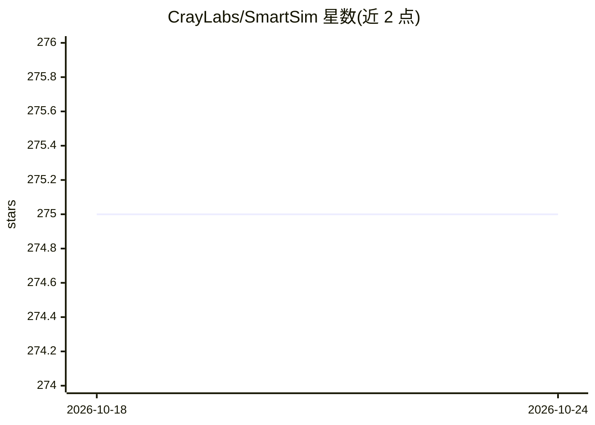

# CrayLabs/SmartSim

⭐ 275 · Python · BSD-2-Clause · 推送 2026-05-14 · [GitHub](https://github.com/CrayLabs/SmartSim) · 组织维护

**在 HPC 系统上启动 ML 与仿真工作流的基础设施库**

SmartSim 是一个 Python 工作流库，用于在 HPC 系统上创建、配置、启动和监控机器学习与仿真应用。它与 SmartRedis 配合：通过 Orchestrator（基于 Redis + RedisAI 的内存数据库）在 GPU/CPU 上远程执行 ML 模型与脚本，使 Fortran/C/C++/Python 应用在运行时跨语言交换张量数据而无需 MPI。支持 Slurm、PBSPro、SGE 等调度器的批处理与交互式启动，也支持本地单节点模式；本地启动不支持批处理工作负载。

## 筛选速览

| 维度 | 判定 | 备注 |
|---|---|---|
| AI 角色 | `ai-ecosystem` | LLM/agent 周边工具 |
| 许可风险 | `permissive` | BSD-2-Clause |
| 部署形态 | `self-host` | docker 或自建部署 |
| 模型依赖 | — | README 未给出锁定关系 |
| 硬件要求 | — | 无带数字的原话,不猜 |
| 安装摩擦 | `low` | 无编译、无系统依赖或容器化 |
| 成熟度 | — | 结构信号不足 |

## 能力要点

- Experiment 接口创建、启动并监控 HPC 上的 ML 与仿真工作流
- Orchestrator（Redis + RedisAI）提供分布式数据库与 ML 推理运行时
- SmartRedis 客户端覆盖 Fortran/C/C++/Python，跨语言交换张量与数据集
- 集成 Slurm/PBSPro/SGE 调度器及本地启动，支持 Ensemble 批量启动

## 适用场景

- 在超算上编排 ML 与仿真的耦合工作流
- 仿真运行中流式传输数据做在线分析与可视化
- 跨语言（Fortran/C/C++/Python）应用间共享张量并远程执行 TorchScript 模型

## 场景标签

`工作流自动化` · 领域:效率与自动化

## 证据(README 行号)

> L28: *SmartSim* is a workflow library that makes it easier to use common Machine Learning (ML)
> L30: and applications. SmartSim launches ML infrastructure on HPC systems alongside user

## 星数曲线

2026-10-18 275 → 2026-10-24 275（+0）

---
*卡片 v1 · prompt 1.4 · 生成 2026-10-22 · 置信度 high · 依据 README sha `635c1e081b7b` · [字段定义](../../DATASET.md)*
