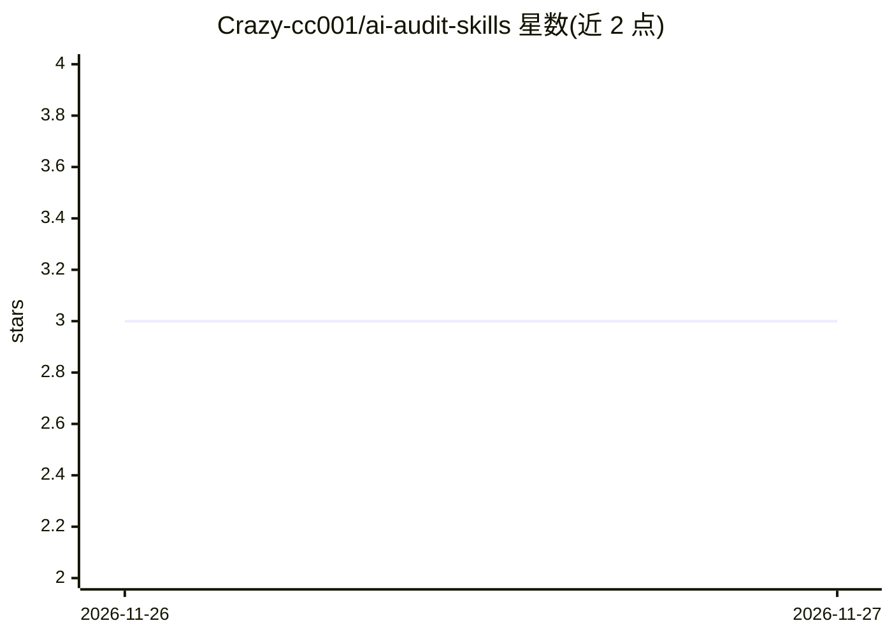

# Crazy-cc001/ai-audit-skills

⭐ 3 · Python · MIT · 推送 2026-11-23 · [GitHub](https://github.com/Crazy-cc001/ai-audit-skills) · 个人维护 · 中文 README

**给审计财务人员的 AI Agent 技能库：对账、底稿、招采审核**

六个面向审计与财务场景的 AI Agent 技能集合，供 Claude Code 及兼容 Agent 加载使用：发票与银行流水对账、对账单与凭证勾稽、审计底稿编制、招采合规审核、PDF/Excel 批量提取。设计上将确定性计算交给 scripts/ 下的本地脚本（解析、匹配、校验、出表），AI 负责理解需求与判断业务归属，输出 Excel 表与报告。底稿技能与金蝶 K3/新纪元账套及特定模板绑定，安装方式为复制技能目录到 ~/.claude/skills。

## 筛选速览

| 维度 | 判定 | 备注 |
|---|---|---|
| AI 角色 | `ai-native` | 本体是模型或模型工具 |
| 许可风险 | `permissive` | MIT |
| 部署形态 | `None` |  |
| 模型依赖 | — | README 未给出锁定关系 |
| 硬件要求 | — | 无带数字的原话,不猜 |
| 安装摩擦 | `low` | 无编译、无系统依赖或容器化 |
| 成熟度 | — | 结构信号不足 |

## 能力要点

- 六个独立技能目录，各含 SKILL.md 作业指导书、scripts 脚本与 references 清单
- 发票流水解析按「XML 数电票 > 原生 PDF > 扫描 PDF-OCR」优先级，四层匹配输出六张 Excel 表
- 招采审核含异常低价、时间节点、评分、投标文件元数据四个检测脚本
- 脚本本地运行，仓库示例已脱敏

## 适用场景

- 代账会计月度全盘发票与流水对账
- 审计项目连续多年账套填底稿并做账表核对
- 政府投资项目招采文件合规审核
- 从投标 PDF 批量提取投标人信息并查重

## 场景标签

`文档解析` · 领域:知识与检索

## 证据(README 行号)

> L6: **English**: A collection of AI-agent skills for audit and finance work — invoice/bank reconciliation, audit working
> L157: AI 会读取对应技能的 `SKILL.md`，按步骤调用 `scripts/` 下的本地脚本，最后把 Excel 和报告交给你。
> L173: ├─ scripts/          # 确定性计算：解析、匹配、校验、出表

## 星数曲线

2026-11-26 3 → 2026-11-27 3（+0）

---
*卡片 v1 · prompt 1.4 · 生成 2026-11-26 · 置信度 high · 依据 README sha `e9f54c5eb009` · [字段定义](../../DATASET.md)*
