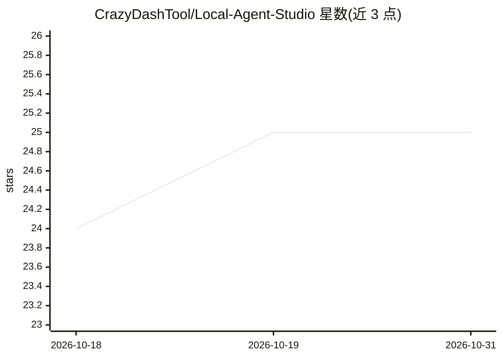

# CrazyDashTool/Local-Agent-Studio

⭐ 25 · JavaScript · Apache-2.0 · 推送 2026-06-29 · [GitHub](https://github.com/CrazyDashTool/Local-Agent-Studio) · 个人维护

**本地优先的桌面 Agent 聊天应用：连接 Ollama/ComfyUI 等本地工具**

基于 Electron+React 的跨平台（Windows/Linux/macOS）桌面聊天应用，界面参照 ChatGPT 类产品。核心能力：通过 Ollama 进行本地流式对话（含推理轨迹与思考开关）、多模态附件、经 ComfyUI 生成图像（内置 Z-Image-Turbo/Flux.2/Ideogram 工作流）、通过 SearXNG/SerpAPI 联网搜索并做摘要、工作区文件操作、从 JSON/CSV 对象创建本地数据库（JSON/CSV/SQLite）、subprocess 或 Docker 沙箱命令、MCP 服务器支持与插件市场。提供 Windows 安装包与源码（Node.js 20+）运行方式；Ollama 与 ComfyUI 为本地服务依赖。

## 筛选速览

| 维度 | 判定 | 备注 |
|---|---|---|
| AI 角色 | `ai-native` | 本体是模型或模型工具 |
| 许可风险 | `permissive` | Apache-2.0 |
| 部署形态 | `desktop` | 安装包/桌面程序 |
| 模型依赖 | local-ok | 支持本地模型 |
| 硬件要求 | — | 无带数字的原话,不猜 |
| 安装摩擦 | `low` | 无编译、无系统依赖或容器化 |
| 成熟度 | — | 结构信号不足 |

## 能力要点

- Ollama 本地流式对话与推理轨迹面板（--think/--no-think 开关）
- ComfyUI 图像生成，内置三种工作流并支持自定义 workflow JSON
- 工作区文件工具、本地数据库生成（JSON/CSV/SQLite）与沙箱命令
- MCP 服务器支持、插件市场与工具权限控制

## 适用场景

- 在桌面端用自有本地模型和 API key 进行带工具的对话
- 让 agent 生成图像、管理文件、建数据库、执行命令
- 通过 SearXNG 自托管搜索并让 agent 汇总回答

## 场景标签

`聊天机器人` `图像生成` · 领域:对话与助手

## 证据(README 行号)

> L7: A ChatGPT/Claude-style desktop app that connects your local and API-powered tools: **Ollama**, **ComfyUI**, web sear
> L17: Local Agent Studio is built for people who want a normal chatbot interface, but with tools they control locally or 

## 星数曲线

2026-10-18 24 → 2026-10-31 25（+1）

---
*卡片 v1 · prompt 1.4 · 生成 2026-10-27 · 置信度 mid · 依据 README sha `78d142bae475` · [字段定义](../../DATASET.md)*
