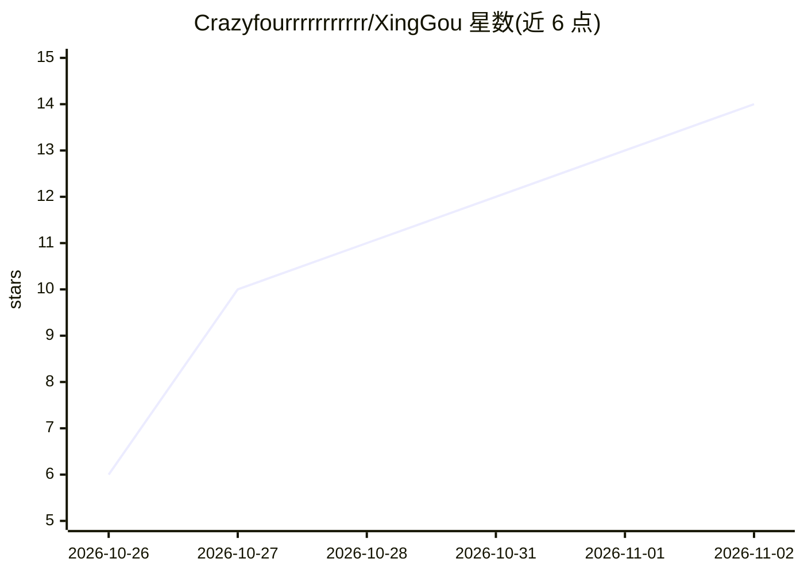

# Crazyfourrrrrrrrrrr/XingGou

⭐ 14 · Python · GPL-3.0 · 推送 2026-10-25 · [GitHub](https://github.com/Crazyfourrrrrrrrrrr/XingGou) · 个人维护 · 中文 README

**千星奇域（原神）本机场景编辑器，文字生成布局并导出 GIA/GLB**

在本地浏览器运行的场景布景工具：搜索/拖放本地 GLB 原生资产、变换编辑、组合与自动保存，导出千星奇域可加载的静态 GIA 或可导入 Blender 的 GLB。布局生成提供两条路径：无密钥的离线确定性规则布局，以及可配置 OpenAI 兼容接口（POST /chat/completions）的文字→草案→场景流程；另提供 stdio MCP 供外部 AI 客户端编辑工程。Windows x64 完整素材版含 2,996 个模型与便携 Python 运行时，双击启动；源码版需自装 Python 3.10+ 与资产库。限制：未绑定模板编号的模型会阻止 GIA 导出，不生成节点图、运动或交互行为。

## 筛选速览

| 维度 | 判定 | 备注 |
|---|---|---|
| AI 角色 | `ai-enhanced` | 去掉 AI 部分产品仍成立 |
| 许可风险 | `viral` | GPL-3.0 |
| 部署形态 | `None` |  |
| 模型依赖 | — | README 未给出锁定关系 |
| 硬件要求 | — | 无带数字的原话,不猜 |
| 安装摩擦 | `low` | 无编译、无系统依赖或容器化 |
| 成熟度 | — | 结构信号不足 |

## 能力要点

- 离线确定性规则布局，无需接口或密钥
- 可配置 OpenAI 兼容接口：文字→设计草案→可编辑场景
- 静态 GIA 导出引用游戏原生模板，GLB 可导入 Blender
- stdio MCP 提供 catalog_search/scene_get/scene_replace/scene_export 等 6 个工具

## 适用场景

- 用千星奇域原生资产在游戏外布景并导出 GIA 导入游戏
- 通过文字描述生成场景草案再手动编辑
- 把布置好的场景导出为 GLB 到 Blender 继续加工
- 让外部 AI 客户端通过 MCP 直接读写同一工程

## 场景标签

 · 领域:游戏/内容创作工具

## 证据(README 行号)

> L18: - 无密钥的离线规则布局，以及可配置的 OpenAI 兼容接口：文字 → 草案 → 场景。
> L129: **AI 模式**在设置中填写 OpenAI 兼容接口地址、模型 ID 和可选密钥。先生成并修改设计草案，再生成可编辑场景，可以替换或追加到工程。
> L5: 在本机浏览器里，用千星奇域的现有原生资产设计场景，把文字想法转成可编辑布局，再导出 GIA 或带材质的 GLB。

## 星数曲线

2026-10-26 6 → 2026-11-02 14（+8）

---
*卡片 v1 · prompt 1.4 · 生成 2026-10-31 · 置信度 high · 依据 README sha `c0c32635879c` · [字段定义](../../DATASET.md)*
