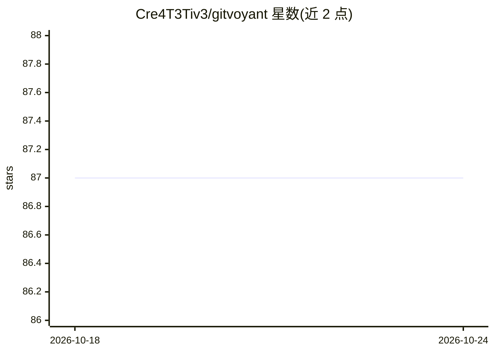

# Cre4T3Tiv3/gitvoyant

⭐ 87 · Python · Apache-2.0 · 推送 2026-03-30 · [GitHub](https://github.com/Cre4T3Tiv3/gitvoyant) · [官网](https://www.gitvoyant.ai/) · 个人维护

**Git 代码复杂度时序分析工具，追踪质量演化趋势**

对 Git 提交历史做时序分析的代码质量工具：逐提交计算圈复杂度，对复杂度时间序列拟合线性回归，按月度变化率分类为 IMPROVING/DECLINING/STABLE，并给出基于提交深度的置信度评分与质量衰减风险预测。支持 Python（ast 模块）、JavaScript/TypeScript、Java、Go（tree-sitter）。以 CLI 与 Python API 提供，另含需 Anthropic API key 的对话式 AI agent 功能；核心时序分析不依赖该 agent。

## 筛选速览

| 维度 | 判定 | 备注 |
|---|---|---|
| AI 角色 | `ai-enhanced` | 去掉 AI 部分产品仍成立 |
| 许可风险 | `permissive` | Apache-2.0 |
| 部署形态 | `None` |  |
| 模型依赖 | — | README 未给出锁定关系 |
| 硬件要求 | — | 无带数字的原话,不猜 |
| 安装摩擦 | `low` | 无编译、无系统依赖或容器化 |
| 成熟度 | — | 结构信号不足 |

## 能力要点

- 跨 Git 提交历史的圈复杂度时序追踪
- 线性回归趋势检测与 IMPROVING/DECLINING/STABLE 分类
- 基于提交深度的置信度评分（10+ 提交达 0.9）
- 支持 Python/JS/TS/Java/Go 四类语言自动识别

## 适用场景

- 在事故发生前发现复杂度加速增长的文件
- 用对话方式询问哪些文件最需关注
- 以 Python API 集成到质量流水线中

## 场景标签

 · 领域:软件开发/代码分析

## 证据(README 行号)

> L19: Static analysis tools tell you a file is complex. GitVoyant tells you whether that complexity is growing, shrinking
> L21: GitVoyant extracts commit history for each file, computes cyclomatic complexity at every snapshot, fits linear regr
> L61: # Add your ANTHROPIC_API_KEY for AI agent features

## 星数曲线

2026-10-18 87 → 2026-10-24 87（+0）

---
*卡片 v1 · prompt 1.4 · 生成 2026-10-23 · 置信度 high · 依据 README sha `8a1aced32d16` · [字段定义](../../DATASET.md)*
