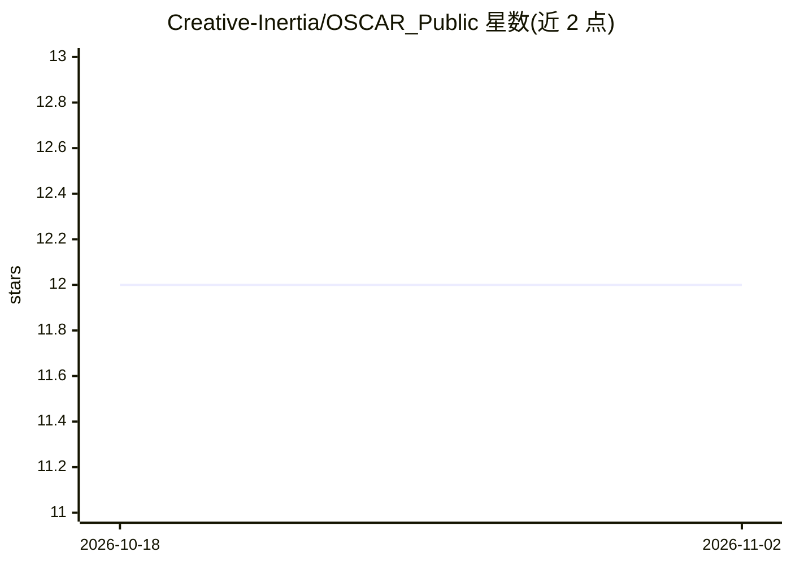

# Creative-Inertia/OSCAR_Public

⭐ 12 · Python · Apache-2.0 · 推送 2026-04-09 · [GitHub](https://github.com/Creative-Inertia/OSCAR_Public) · 个人维护

**让 Claude Code 通过自然语言驱动 Fusion 360 建模的 MCP 构建包**

一个开源构建包：将主提示词喂给 Claude Code 后，自动生成 Fusion 360 插件与 FastMCP 服务器，构成双进程桥（MCP over stdio → localhost HTTP POST），使 Claude 能在本机进行全参数化、基于时间线的 3D 建模。仅绑定 127.0.0.1、随机 Bearer token 认证、无二进制与自动更新器。README 声明它不是专家级 CAD 设计者，初期运行较慢，且不适合不熟悉 Fusion 的用户；学习笔记可私有保存或公开共享。

## 筛选速览

| 维度 | 判定 | 备注 |
|---|---|---|
| AI 角色 | `ai-native` | 本体是模型或模型工具 |
| 许可风险 | `permissive` | Apache-2.0 |
| 部署形态 | `library` | 以包/库形式分发 |
| 模型依赖 | locked-api |  |
| 硬件要求 | — | 无带数字的原话,不猜 |
| 安装摩擦 | `low` | 无编译、无系统依赖或容器化 |
| 成熟度 | — | 结构信号不足 |

## 能力要点

- Claude Code → MCP 服务器（FastMCP/stdio）→ Fusion 插件（localhost HTTP）双进程桥接
- 主提示词驱动 Claude Code 自动构建整套系统
- 安全设计：仅 localhost 绑定、每次启动随机 Bearer token、无二进制、无自动更新
- experience/ 目录支持学习笔记的私有保存与社区共享

## 适用场景

- 通过对话让 Claude Code 在 Fusion 360 中做参数化建模
- 让 AI 辅助命名参数并操作时间线特征
- 积累并分享 Fusion API 使用经验以改进后续会话

## 场景标签

 · 领域:CAD/设计自动化

## 证据(README 行号)

> L3: A secure MCP (Model Context Protocol) server that gives Claude Code the ability to build parametric, time-line based
> L7: OSCAR is a build package that creates a two-process bridge between Claude Code and Fusion 360 on your local computer
> L17: Claude Code ──stdio──> MCP Server (FastMCP, Python)

## 星数曲线

2026-10-18 12 → 2026-11-02 12（+0）

---
*卡片 v1 · prompt 1.4 · 生成 2026-11-01 · 置信度 mid · 依据 README sha `d85e6e40675b` · [字段定义](../../DATASET.md)*
