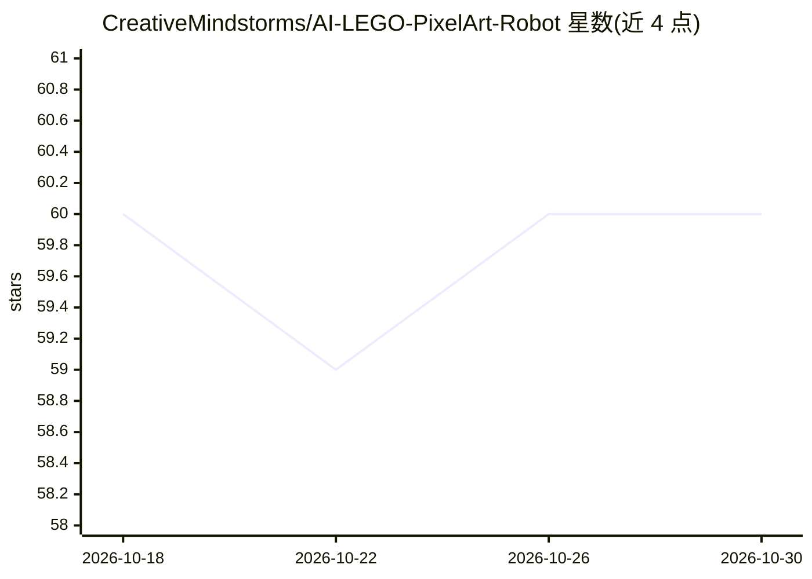

# CreativeMindstorms/AI-LEGO-PixelArt-Robot

⭐ 60 · Python · GPL-3.0 · 推送 2026-02-11 · [GitHub](https://github.com/CreativeMindstorms/AI-LEGO-PixelArt-Robot) · [官网](https://youtu.be/ec_BtS97IR8) · 个人维护

**用 DALL·E 3 生成像素图并控制乐高 Mindstorms 拼装机器**

为 YouTube 视频演示配套的个人 Python 代码：调用 OpenAI DALL·E 3 API 生成图像，或将自定义图像缩放/取网格中心转为像素图，再通过蓝牙控制乐高 Mindstorms EV3 拼装机器摆放彩色颗粒；也提供无需 Mindstorms 的版本仅做图像处理。作者声明代码为个人用途编写，不能直接运行，需修改 API key、蓝牙地址、电机端口与颜色配置等变量，且项目不再更新，最后一次成功测试为 2024 年 6 月 15 日。

## 筛选速览

| 维度 | 判定 | 备注 |
|---|---|---|
| AI 角色 | `ai-native` | 本体是模型或模型工具 |
| 许可风险 | `viral` | GPL-3.0 |
| 部署形态 | `None` |  |
| 模型依赖 | — | README 未给出锁定关系 |
| 硬件要求 | — | 无带数字的原话,不猜 |
| 安装摩擦 | `low` | 无编译、无系统依赖或容器化 |
| 成熟度 | `idea` | |

## 能力要点

- 调用 DALL·E 3 生成图像并转为指定尺寸像素图
- 通过蓝牙控制 Mindstorms EV3 电机与传感器完成颗粒摆放
- 提供无需 Mindstorms 硬件的纯图像处理版本
- 可配置可用颜色、像素尺寸、颗粒仓余量提醒等参数

## 适用场景

- 搭建自己的乐高像素画机器并复用其控制代码
- 把 AI 生成图像或本地图片转为乐高像素画布局
- 研究 EV3 蓝牙通信与机械臂电机控制实现

## 场景标签

`图像生成` `图像视频处理` · 领域:内容生成

## 证据(README 行号)

> L7: The code generates pixelart using OpenAI's Dall-E 3 and controls a Lego Pixelart machine using Mindstorms.
> L19: - You will need to get your own OpenAI API key and rename the variable in the "imageGenerator.py" file.

## 星数曲线

2026-10-18 60 → 2026-10-30 60（+0）

---
*卡片 v1 · prompt 1.4 · 生成 2026-10-24 · 置信度 high · 依据 README sha `9f75be2e8e23` · [字段定义](../../DATASET.md)*
