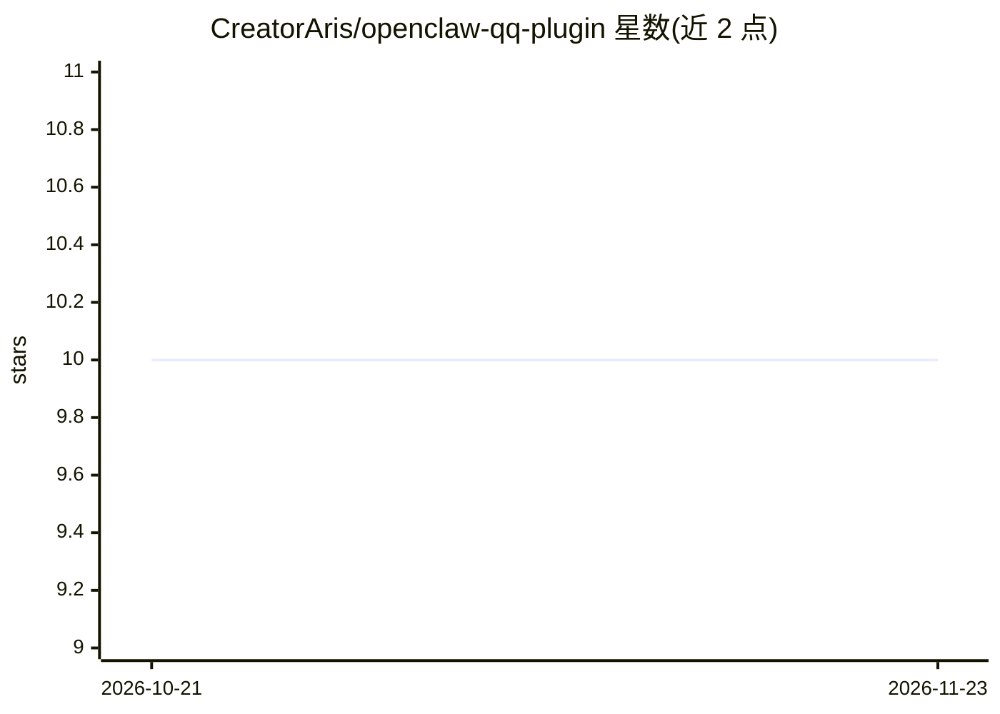

# CreatorAris/openclaw-qq-plugin

⭐ 10 · JavaScript · MIT · 推送 2026-02-19 · [GitHub](https://github.com/CreatorAris/openclaw-qq-plugin) · 个人维护 · 中文 README

**让 OpenClaw 通过 NapCat 接入 QQ 收发消息的插件**

OpenClaw 的 QQ 渠道插件，通过 NapCat（OneBot v11 WebSocket）连接 QQ：支持私聊与群聊（@提及触发）、图片消息自动下载供 AI 分析、会话上下文重置（/reset）、消息去重、用户/群白名单，以及可选的 HTTP 端点用于主动发送消息。以 OpenClaw 插件形式安装，随 Gateway 自动启停。前置条件包括已运行 OpenClaw、Node.js >= 18、已配置 OneBot v11 WebSocket 的 NapCat 和一个机器人 QQ 账号。

## 筛选速览

| 维度 | 判定 | 备注 |
|---|---|---|
| AI 角色 | `ai-ecosystem` | LLM/agent 周边工具 |
| 许可风险 | `permissive` | MIT |
| 部署形态 | `None` |  |
| 模型依赖 | — | README 未给出锁定关系 |
| 硬件要求 | — | 无带数字的原话,不猜 |
| 安装摩擦 | `low` | 无编译、无系统依赖或容器化 |
| 成熟度 | — | 结构信号不足 |

## 能力要点

- 通过 NapCat（OneBot v11 WebSocket）连接 QQ，支持私聊与群聊
- 图片消息自动下载供 AI 分析，@提及触发群聊回复
- 用户/群白名单、消息去重与 /reset 上下文重置
- 可选 HTTP 端点主动发送消息，随 OpenClaw Gateway 自动启停

## 适用场景

- 让已有的 OpenClaw Gateway 通过 QQ 与用户对话
- 在 QQ 群中通过 @机器人 获取 AI 回复
- 通过 HTTP 接口向指定 QQ 用户主动推送消息

## 场景标签

`聊天机器人` · 领域:对话与助手

## 证据(README 行号)

> L5: QQ channel plugin for OpenClaw via NapCat (OneBot v11).
> L24: - Runs as an OpenClaw plugin, auto start/stop with Gateway
> L111: QQ Client -> QQ Server -> NapCat (OneBot v11) -> Plugin (WebSocket) -> OpenClaw Gateway -> AI Model

## 星数曲线

2026-10-21 10 → 2026-11-23 10（+0）

---
*卡片 v1 · prompt 1.4 · 生成 2026-11-20 · 置信度 high · 依据 README sha `b1ac028ea2d1` · [字段定义](../../DATASET.md)*
