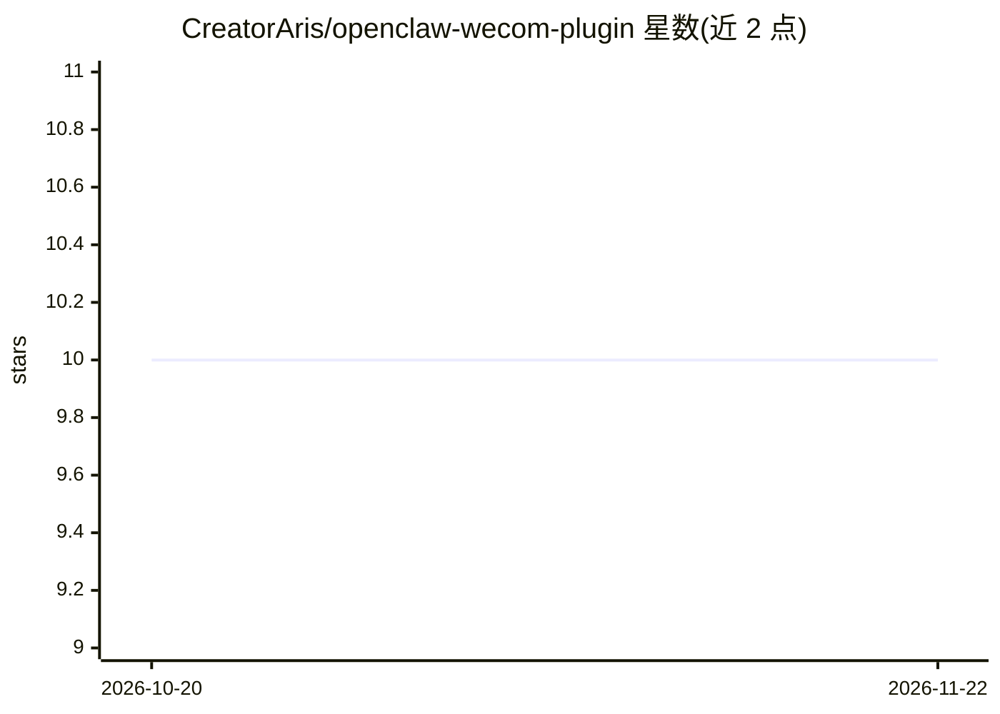

# CreatorAris/openclaw-wecom-plugin

⭐ 10 · JavaScript · MIT · 推送 2026-02-10 · [GitHub](https://github.com/CreatorAris/openclaw-wecom-plugin) · [官网](https://www.npmjs.com/package/@creatoraris/openclaw-wecom) · 个人维护 · 中文 README

**把 OpenClaw AI 助手接入企业微信的通道插件**

OpenClaw 的企业微信（WeCom）通道插件：提供 HTTP 回调服务器接收 WeCom 智能机器人消息，经 AES-256-CBC 加解密、签名校验与消息去重后转发至 OpenClaw Gateway，AI 回复以流式分块返回。支持私聊与群聊、图片消息（自动解密 WeCom 加密图片）、/reset 重置上下文，随 Gateway 自动启停。前置条件为 OpenClaw 已运行、Node.js ≥18、可公网访问的 webhook 端点（可用 ngrok/Tailscale 隧道）。

## 筛选速览

| 维度 | 判定 | 备注 |
|---|---|---|
| AI 角色 | `ai-ecosystem` | LLM/agent 周边工具 |
| 许可风险 | `permissive` | MIT |
| 部署形态 | `None` |  |
| 模型依赖 | — | README 未给出锁定关系 |
| 硬件要求 | — | 无带数字的原话,不猜 |
| 安装摩擦 | `low` | 无编译、无系统依赖或容器化 |
| 成熟度 | — | 结构信号不足 |

## 能力要点

- 流式分块回复与 AES-256-CBC 消息加解密
- 私聊与群聊支持，图片消息自动解密
- 作为 OpenClaw 插件运行，随 Gateway 自动启停
- 消息签名校验与去重防重放

## 适用场景

- 让企业微信机器人收发 AI 助手回复
- 企业内部通过 WeCom 群聊使用 OpenClaw 能力
- 本地开发时用 ngrok 隧道调试回调

## 场景标签

`聊天机器人` · 领域:对话与助手

## 证据(README 行号)

> L5: Enterprise WeChat (WeCom) channel plugin for OpenClaw. Connect your OpenClaw AI assistant to WeCom.
> L97: WeCom Client -> WeCom Server -> Plugin (HTTP Server) -> OpenClaw Gateway -> AI Model

## 星数曲线

2026-10-20 10 → 2026-11-22 10（+0）

---
*卡片 v1 · prompt 1.4 · 生成 2026-11-20 · 置信度 high · 依据 README sha `7d99bb6d9499` · [字段定义](../../DATASET.md)*
