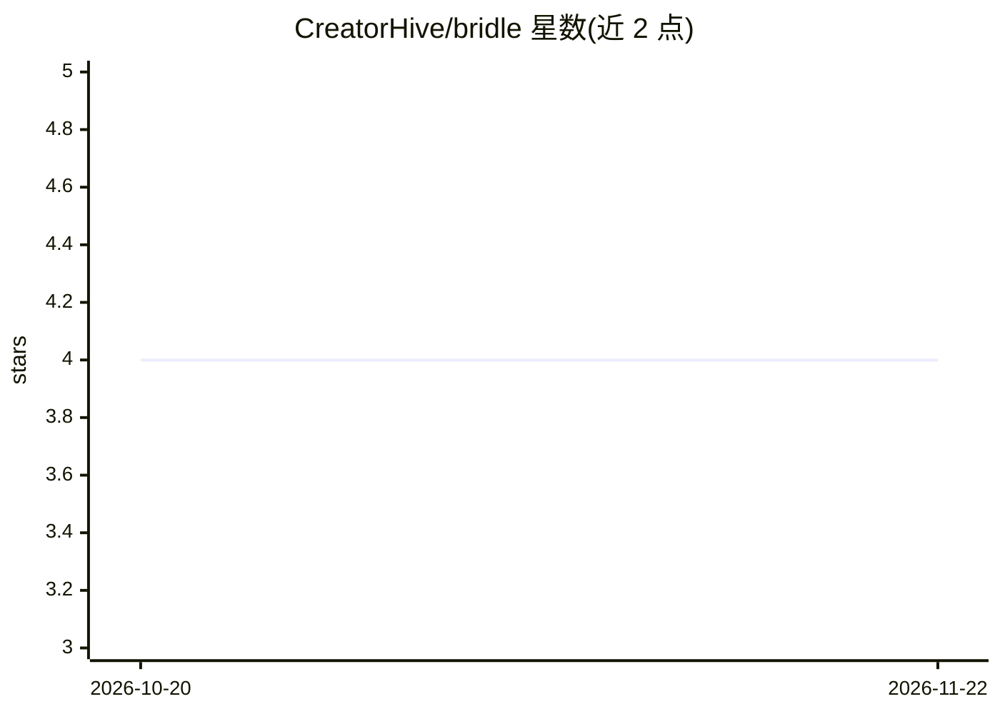

# CreatorHive/bridle

⭐ 4 · TypeScript · MIT · 推送 2026-10-13 · [GitHub](https://github.com/CreatorHive/bridle) · 个人维护

**macOS/Linux 个人 agent：主动阅读邮件日历并先写好回复**

以 Electron 构建的开源个人 agent，运行于 macOS 与 Linux。它读取邮件、日历与 GitHub 的新动态，识别他人正在等待的事项并预先起草邮件、回复与邀请，用户确认后才发送。所有数据存于本地一个纯文本文件夹（人设、记忆、任务、文件），可用 Finder/grep/git 查看。模型默认经 Claude Code 接入，也可指向任何 OpenAI 兼容端点；语义搜索、OCR、转写在本机运行，需 macOS 26 与 Xcode 26 构建原生 helper，未构建时搜索退化为按词匹配。

## 筛选速览

| 维度 | 判定 | 备注 |
|---|---|---|
| AI 角色 | `ai-native` | 本体是模型或模型工具 |
| 许可风险 | `permissive` | MIT |
| 部署形态 | `library` | 以包/库形式分发 |
| 模型依赖 | local-ok | 支持本地模型 |
| 硬件要求 | — | 无带数字的原话,不猜 |
| 安装摩擦 | `medium` | 含编译或系统依赖之一 |
| 成熟度 | `idea` | |

## 能力要点

- 主动提示与草拟：他人等待事项先被发现并附草稿，用户按键确认才发送
- 工作区为一个纯文本文件夹（AGENTS.md/SOUL.md/MEMORY.md 等），可 git 管理
- 每个任务独立的 git worktree，agent 并行运行、产出可读 diff
- 本地运行的语义搜索、OCR 与转写；支持自定义 MCP server

## 适用场景

- 集中处理 Gmail 与 Google Calendar，由 agent 起草回复和 RSVP 待确认
- 让 agent 在 Linear 任务板上运行任务直至完成
- 用 ⌘K 对邮件、文件、会议做语义搜索
- 用定时 Loops 每天早晨生成日程简报

## 场景标签

`AI 助手` `语义搜索` · 领域:对话与助手

## 证据(README 行号)

> L20: Most assistants wait to be asked. Bridle reads what's new in your mail, calendar and GitHub, notices what someone
> L48: |🔌 **Your models and tools**|Claude through Claude Code by default, or any OpenAI-compatible endpoint (OpenRouter, 

## 星数曲线

2026-10-20 4 → 2026-11-22 4（+0）

---
*卡片 v1 · prompt 1.4 · 生成 2026-11-21 · 置信度 high · 依据 README sha `02babea18255` · [字段定义](../../DATASET.md)*
